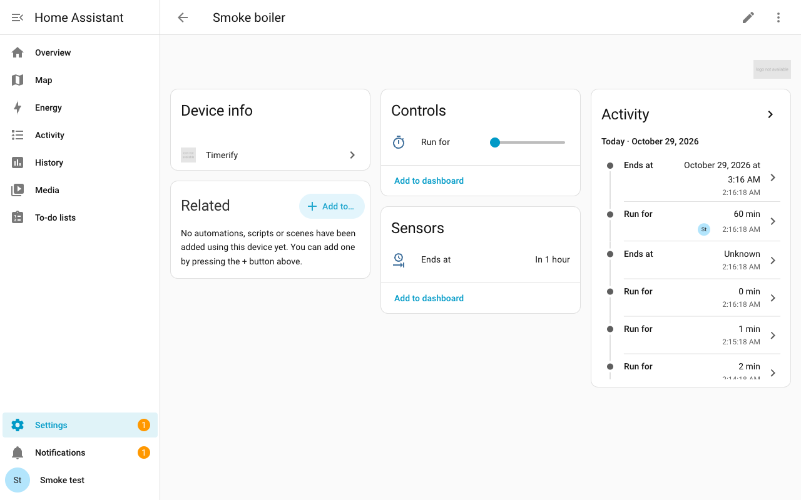

  

<h1 align="center">Timerify</h1>

  
  
  

  English | <a href="https://github.com/klimofey/timerify/blob/main/README.ru.md">Russian</a>

Timers for any Home Assistant entity, without writing automations.

Timerify attaches a countdown to an entity you already have, the way Powercalc attaches a virtual power sensor to a device. A boiler that is just a smart switch gains a "Run for" control on its own device page. Set 10 minutes, and the boiler turns on and turns itself off when the time is up.

## Installation

The first button opens Timerify in HACS, or in the Marketplace on Home Assistant 2026.11 and later. The second opens the Timerify menu, where you choose **Add a timer**. It works once Timerify is installed. Home Assistant 2026.10.4 or newer is required.

### Home Assistant 2026.10: HACS

1. In HACS, open the menu (three dots, upper right) and choose **Custom repositories**.
2. Enter the repository `https://github.com/klimofey/timerify` and the type **Integration**. Choose **Add**.
3. Find Timerify in HACS and download it.

### Home Assistant 2026.11 and later: Marketplace

1. Open **Settings > Marketplace**.
2. Choose **Add from link** (upper right).
3. In **GitHub link**, enter `klimofey/timerify` and choose **Add**. Home Assistant asks you to connect GitHub the first time.
4. If it asks for the type, choose **Integration** and choose **Add** again.
5. Open Timerify in the list and install it.

### By hand

Copy the `custom_components/timerify` folder of this repository into the `custom_components` folder of your Home Assistant configuration.

### After you install Timerify

Restart Home Assistant. Add a timer with the second button, or under **Settings > Devices & services > Helpers**: choose **Create helper**, then **Timerify**. The [Timers page](https://github.com/klimofey/timerify/blob/main/docs/en/timers.md#add-a-timer-to-a-device) has the steps.

The dashboard card comes with Timerify. Refresh your browser once after you install or update Timerify.

## What it can do

- [Timers](https://github.com/klimofey/timerify/blob/main/docs/en/timers.md): run a switch, a light, a fan or an air conditioner for a set time, and it turns itself off. A device that is left on can be turned off after a limit you choose.
- [Pending commands](https://github.com/klimofey/timerify/blob/main/docs/en/pending-commands.md): tell a timer to turn its device on or off at a time you choose, up to 7 days ahead.
- [Schedules](https://github.com/klimofey/timerify/blob/main/docs/en/schedules.md): run a device at set times of the week, on the weekdays you pick, or by your Workday sensor.
- [Automations](https://github.com/klimofey/timerify/blob/main/docs/en/automations.md): run, extend and stop a timer from an automation, and react when a countdown starts or ends, or a pending command comes due.
- [Voice](https://github.com/klimofey/timerify/blob/main/docs/en/voice.md): tell Assist "turn on the boiler for 10 minutes" or ask how long is left, in English or Russian.
- [Dashboard card](https://github.com/klimofey/timerify/blob/main/docs/en/card.md): show a timer on a dashboard, and run, extend and stop it from a pop-up.
- [Runtime counter](https://github.com/klimofey/timerify/blob/main/docs/en/runtime.md): optionally add up how long a device was on, to see how many hours the boiler ran this week.

## More

- [All pages](https://github.com/klimofey/timerify/blob/main/docs/en/README.md)
- [Actions](https://github.com/klimofey/timerify/blob/main/docs/en/services.md): the five actions that Timerify adds to Home Assistant, and the three events that it fires.
- [Limits](https://github.com/klimofey/timerify/blob/main/docs/en/limits.md): what Timerify does not do yet.
- [Known faults and requests](https://github.com/klimofey/timerify/issues): the GitHub issues.
- [Contributing](https://github.com/klimofey/timerify/blob/main/CONTRIBUTING.md): how to work on Timerify itself.

## License

MIT. See [LICENSE](https://github.com/klimofey/timerify/blob/main/LICENSE).
