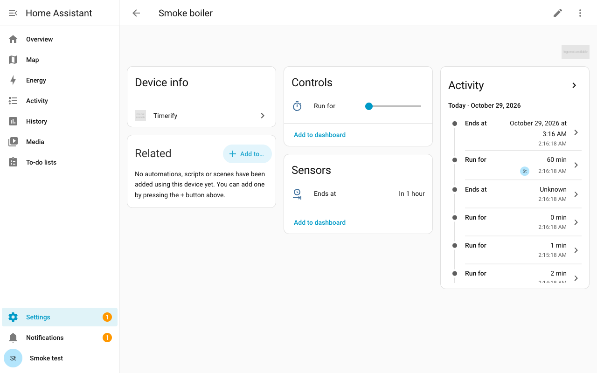

  

<h1 align="center">Timerify</h1>

  
  
  

  <a href="https://github.com/klimofey/timerify/blob/main/README.md">English</a> | Русский

Таймеры для любого объекта Home Assistant, без написания автоматизаций.

Timerify добавляет отсчёт к объекту, который у вас уже есть, так же как Powercalc добавляет виртуальный датчик мощности к устройству. Котёл, который всего лишь умный выключатель, получает на странице своего устройства элемент «Включить на». Задайте 10 минут, и котёл включится, а когда время выйдет, сам выключится.

## Установка

Первая кнопка открывает Timerify в HACS, а в Home Assistant 2026.11 и новее в Marketplace. Вторая открывает меню Timerify, где вы выбираете **Добавить таймер**. Она работает, когда Timerify уже установлен. Нужен Home Assistant 2026.10.4 или новее.

### Home Assistant 2026.10: HACS

1. В HACS откройте меню (три точки справа вверху) и выберите «Custom repositories».
2. Введите репозиторий `https://github.com/klimofey/timerify` и тип «Integration». Нажмите «Add».
3. Найдите Timerify в HACS и скачайте его.

### Home Assistant 2026.11 и новее: Marketplace

1. Откройте **Настройки > Marketplace**.
2. Нажмите **Добавить по ссылке** (справа вверху).
3. В поле **Ссылка на GitHub** введите `klimofey/timerify` и нажмите **Добавить**. В первый раз Home Assistant предложит подключить GitHub.
4. Если он спросит тип, выберите **Интеграция** и нажмите **Добавить** ещё раз.
5. Откройте Timerify в списке и установите его.

### Вручную

Скопируйте папку `custom_components/timerify` этого репозитория в папку `custom_components` вашей конфигурации Home Assistant.

### После установки Timerify

Перезапустите Home Assistant. Добавьте таймер второй кнопкой или в разделе **Настройки > Устройства и службы > Вспомогательное**: нажмите **Создать вспомогательный объект**, затем выберите **Timerify**. Шаги описаны на странице [«Таймеры»](https://github.com/klimofey/timerify/blob/main/docs/ru/timers.md#добавьте-таймер-к-устройству).

Карточка для панели поставляется вместе с Timerify. Один раз обновите страницу в браузере после установки или обновления Timerify.

## Что он умеет

- [Таймеры](https://github.com/klimofey/timerify/blob/main/docs/ru/timers.md): включайте выключатель, свет, вентилятор или кондиционер на заданное время, и он сам выключится.
- [Ожидающие команды](https://github.com/klimofey/timerify/blob/main/docs/ru/pending-commands.md): велите таймеру включить или выключить устройство в выбранное вами время, не дальше чем на 7 дней вперёд.
- [Расписания](https://github.com/klimofey/timerify/blob/main/docs/ru/schedules.md): запускайте устройство в заданное время недели, в выбранные вами дни недели или по датчику Workday.
- [Автоматизации](https://github.com/klimofey/timerify/blob/main/docs/ru/automations.md): запускайте, продлевайте и останавливайте таймер из автоматизации.
- [Голос](https://github.com/klimofey/timerify/blob/main/docs/ru/voice.md): скажите Assist «включи Котёл на 10 минут» или спросите, сколько осталось, на английском или русском.
- [Карточка на панели](https://github.com/klimofey/timerify/blob/main/docs/ru/card.md): показывайте таймер на панели, а во всплывающем окне включайте, продлевайте и останавливайте его.
- [Счётчик времени работы](https://github.com/klimofey/timerify/blob/main/docs/ru/runtime.md): по желанию складывайте, сколько времени устройство было включено, чтобы узнать, сколько часов котёл проработал за неделю.

## Дальше

- [Все страницы](https://github.com/klimofey/timerify/blob/main/docs/ru/README.md)
- [Действия](https://github.com/klimofey/timerify/blob/main/docs/ru/services.md): пять действий, которые Timerify добавляет в Home Assistant, и три события, которые он отправляет.
- [Ограничения](https://github.com/klimofey/timerify/blob/main/docs/ru/limits.md): чего Timerify пока не умеет.
- [Известные ошибки и запросы](https://github.com/klimofey/timerify/issues): задачи на GitHub.
- [Участие в разработке](https://github.com/klimofey/timerify/blob/main/CONTRIBUTING.md): как работать над самим Timerify (страница на английском).

## Лицензия

MIT. См. [LICENSE](https://github.com/klimofey/timerify/blob/main/LICENSE).
