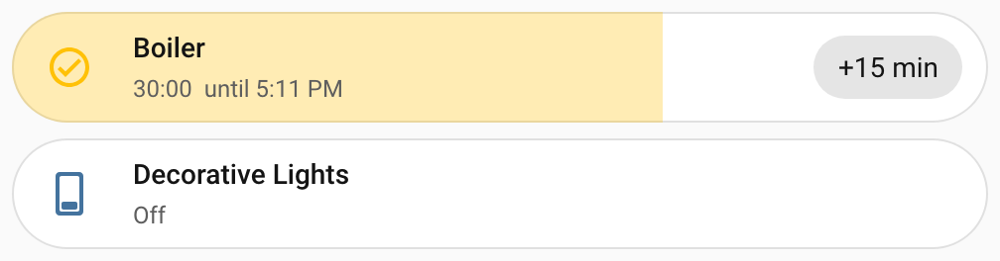
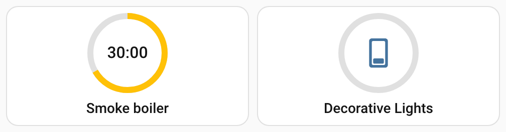
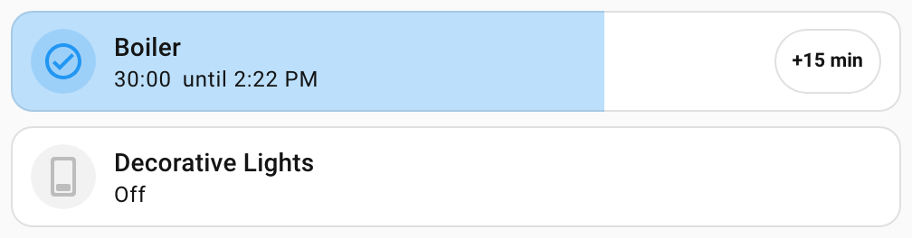
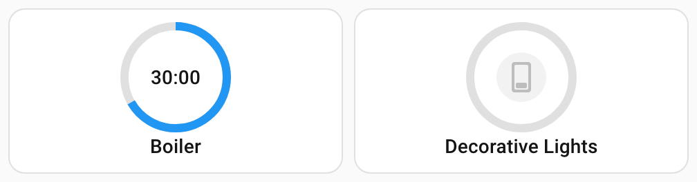

# Dashboard card

Timerify brings a dashboard card for one timer. It shows the countdown at a glance.

A tap opens a pop-up. There you run the timer for a set time, add or take off minutes, and stop it. You also switch the intervals of its schedule and cancel pending commands. The card has two layouts and a visual editor. You can set what a tap, a double tap and a long press do. You can also add a **Turn off** button to the card, and give it the look of Mushroom's cards.

## Loading the card

There is nothing to add. Timerify serves the card and tells Home Assistant to load it on every dashboard. You create no resource under **Dashboards**. Dashboards in YAML mode have the card too.

Home Assistant reads the list of modules to load when a page loads. So **refresh the browser once after you install or update Timerify**.

### Known issue on Home Assistant 2026.10

A card that an integration loads can be missing on a first load. That is a load in a browser that has not cached the frontend yet. This happens on a first visit, after the site data was cleared, and on the first load after the frontend was updated.

The dashboard then shows "Configuration error" and "Custom element doesn't exist: timerify-card". Refresh the page once more, and the card is there.

- This is a fault of Home Assistant's frontend ([home-assistant/frontend#53890](https://github.com/home-assistant/frontend/issues/53890)). Every such card meets it.
- It is fixed in the frontend from version 20261028.0 on ([pull request #54444](https://github.com/home-assistant/frontend/pull/54444)). Home Assistant 2026.11 is expected to carry that frontend.
- Timerify does not work around it. Timerify still needs only Home Assistant 2026.10.4. Raising the minimum to 2026.11 would remove the problem ([issue #7](https://github.com/klimofey/timerify/issues/7)).

## The two layouts

The **pill** is a card one row high. Its fill grows from the left. It shows the share of the countdown that is left: full when the countdown starts, empty when it ends.

On the pill are the icon of the device, its name, and the time left with the moment the countdown ends. When nothing counts, the state of the device stands in their place. An optional chip, "+15 min" in the picture, adds time without opening the pop-up. An optional **Turn off** button stands before the chip. See [The Turn off button](#the-turn-off-button).



The **round** tile is made to sit several in a row. A ring shows the same share. While the countdown runs, the time left is in its centre. Otherwise the centre shows the icon of the device. The name is below.

The round tile has no chip. A long press on it starts or stops the timer. See [Presses](#presses). Its optional **Turn off** button is below the name.



- The name and the icon are the device's. The icon follows the device's state, as it does on any card. You can set both in the card's configuration.
- A device that is on with no countdown shows a full fill and a full ring. **Loose** mode allows this. The [Modes](timers.md#modes) section explains it. The pill says the state of the device in words. The round tile has the words for screen readers only. An idle timer shows an empty fill and an empty ring.
- A timer whose number is unavailable shows that. Its chip, presets, plus, minus, Stop and cancel buttons are off, and the **Turn off** button is not shown. See [The pop-up](#the-pop-up).
- Suppose the entity of the card does not exist, or is not the **Run for** number of a Timerify timer. The card says so and names it. It finds its timer again by itself when the entity is back. After you rename the number, point the card at its new entity id.
- Sometimes the number is a timer's, but the timer cannot be shown. That happens when the device or one of the two sensors is missing from the registry. The card says that and sends you to the timer's page to see why. It does so whatever the state of the number. Right after you add a timer, the line can show for a moment. It goes away by itself.
- The card never goes quiet when it cannot work. A user who may not see the timer is told so. See [Permissions](#permissions).
- The card needs the timer's two sensors, **Ends at** and **Next command**. It tells you when you have disabled one of them.
  - With **Ends at** disabled, the card has no countdown to show. It shows only a warning that names the sensor and says to enable it.
  - With **Next command** disabled, the card works. The pop-up says, in the place of the pending commands, that they are hidden. It names the sensor.
  - Enable the sensor in its entity settings. Home Assistant reloads the timer about half a minute later, and the card returns by itself.
- A countdown carries on across a restart of Home Assistant or a lost connection, to the same end. The card asks for its timer again when the connection returns.
- In a dashboard with sections, the pill starts 6 columns wide and one row high. It can be made as narrow as 3 columns. The round tile starts 3 columns wide and 2 rows high. It can be made 2 columns wide or 3 rows high. The **Turn off** button needs more room. See [The Turn off button](#the-turn-off-button).

## Add the card

Edit a dashboard, choose **Add card** and find **Timerify** among the cards. The picker shows the first timer you have, and the editor opens with the form below. Or write the card in YAML.

Every option is shown here with its default:

```yaml
type: custom:timerify-card
entity: number.boiler_run_for             # required: the "Run for" number of the timer
layout: pill                              # pill (the default) or round
name: Boiler                              # default: the name of the device
icon: mdi:water-boiler                    # default: the icon of the device, which follows its state
presets: ["15", "30", "45", "60", "120"]  # the default: the minutes the pop-up offers
chip: 15                                  # no chip by default: the pill's "+15 min" chip
show_turn_off: false                      # true shows a Turn off button while the device is on
mushroom: false                           # true gives the card the look of Mushroom's cards, if Mushroom is installed
tap: popup                                # popup (the default), run, stop, run_or_stop, action or none
double_tap: none                          # the same choices, none by default
hold: none                                # the same choices, run_or_stop on the round tile by default
tap_action:                               # a Home Assistant action, used when tap is action
  action: more-info
```

| Option | Default | What it is |
| --- | --- | --- |
| `entity` | none, required | The **Run for** number of a timer. The card finds the rest of the timer from it, never by device. So two timers on one device are told apart. |
| `layout` | `pill` | `pill` or `round`. |
| `name` | the device's name | Replaces the name. |
| `icon` | the device's icon | An icon such as `mdi:water-boiler`. It does not follow the state. |
| `presets` | 15, 30, 45, 60 and 120 | The durations the pop-up offers, in whole minutes from 1 to 1440, each shown once, in the order given. Numbers and text of digits (`"30"`) both work. An empty list means the defaults. The pop-up does not show a preset that is longer than the timer's **Maximum of Run for**. Home Assistant would refuse it. |
| `chip` | none | Whole minutes from 1 to 1440, added to the countdown by the pill's chip. The round tile ignores it. |
| `show_turn_off` | `false` | `true` shows a **Turn off** button on the card while the device is on. See [The Turn off button](#the-turn-off-button). |
| `mushroom` | `false` | `true` gives the card the look of Mushroom's cards, when Mushroom is installed. See [The Mushroom style](#the-mushroom-style). |
| `tap` | `popup` | What a tap does. One of `popup`, `run`, `stop`, `run_or_stop`, `action` and `none`. See [Presses](#presses). |
| `double_tap` | `none` | What a double tap does. The same choices. |
| `hold` | `run_or_stop` on the round tile, `none` on the pill | What a long press does. The same choices. |
| `tap_action`, `double_tap_action`, `hold_action` | none | A Home Assistant action, written as settings such as `action: more-info`. It is used when that press is set to `action`. |

An option that the card does not know is ignored. A value that it cannot use is shown as a message on the card, which says what is wrong.

### The visual editor

The visual editor has a field for each option. It offers only the **Run for** numbers of Timerify timers. A card added from the picker is written with the pill layout and the five default presets, so you see them. A few things about the editor:

- It writes presets as text (`"15"`). Write them as text in YAML too, if you edit the card in the form afterwards. A list of numbers (`[15, 30]`) is shown in the form as bare chips ("15", not "15 min"). Its drop-down offers the defaults again, even when they are in the list. Picking one adds a second copy, which the card ignores.
- Taking the last preset away leaves the list empty, which means the defaults.
- The **Mushroom style** field says **Mushroom was not found** under it while Mushroom's cards are not loaded on the page. See [The Mushroom style](#the-mushroom-style).
- The three presses and their actions are in the **Interactions** group. It stays closed until you open it. A press you have not set shows an empty field, and does its default.
- A value that the form accepts but the card cannot use, such as a preset of 0, stays in the form. The preview shows the card's message. Only a value of the wrong kind sends the editor to YAML. An example is presets that are not a list.
- A card written by hand without a layout is a pill. But the form does not preselect it, because Home Assistant's editor does not apply the defaults of a form.
- Home Assistant itself translates the names of the fields. Some words are not translated that way: the two layouts, the six press choices and the labels of the presets. They are in the language of the last card that the page loaded. Before any card has loaded on the page, they are in English.

## The pop-up

By default a tap anywhere on the card opens it, the border included. The chip and the **Turn off** button are the exceptions, because each has its own job. The card is a button for the keyboard and assistive technology too. Focus it with Tab and press Enter or Space.

The pop-up is a modal dialog. Escape, the **Close** button and a click on the dimmed page behind it close it. From top to bottom it holds:

- **The time left**, and when it ends, while a countdown runs.
- **The presets.** Pressing one runs the timer for that long, as setting **Run for** does. It restarts a countdown that runs. A preset that is longer than the timer's **Maximum of Run for** is not shown. If none is left, the row is left out.
- **Take off 5 minutes, add 5 minutes, and Stop.** Taking time off is offered while a countdown runs. Adding time to a timer that is idle starts it, as the [**Add time** action](services.md#add-time) does. Stop is offered while the timer runs, with a countdown or without. It turns the device off and ends the countdown.
- **Schedule**, when the timer has intervals. It shows a switch for each interval, named by its title. Each one turns the [switch of the interval](schedules.md#switch-an-interval-on-or-off) on and off. You do not create or edit intervals here. Use the timer's page. An interval whose switch is unavailable is shown as that and cannot be pressed.
- **Pending commands**, when there are some. Each shows like "On at 7:30 AM for 1 hr" or "Off at Tue 7:00 AM". It also shows its settings ("Cool, 24 °C") and a × button that cancels it. If the **Next command** sensor is disabled, one line stands here instead. It says that the commands are hidden because of it.
- **Settings**, a link to the timer's page in the settings of the integration. Only administrators see it. It opens in the same tab and closes the pop-up. Ctrl, Cmd or Shift with the click open it in a new tab or window, and the pop-up stays.

A timer that is unavailable has nothing to act on. Its presets, plus, minus, Stop and cancel buttons are off, and so is the pill's chip. The **Turn off** button is not shown. When Home Assistant refuses an action, it shows its own error message, and the pop-up stays open.

Times follow your profile: its language, its 12 or 24 hour clock and its time zone, the server's or the browser's. A time on the same day is shown as a time. Within the next six days it is shown with the short weekday. Further ahead it is shown with the date. Durations such as "1 hr 30 min" are written for your language.

## The Turn off button

The pop-up has a **Stop** button. You can also show a **Turn off** button on the card itself. Then you stop the timer without opening the pop-up. The button is off by default. Turn it on with **Show a Turn off button** in the visual editor. In YAML, write `show_turn_off: true`.

- The button shows while the device is on, with a countdown or without one. While a countdown runs, it shows even if the device is unavailable.
- It is not shown while the device is off. It is not shown while the timer is unavailable, or before the card has found its timer.
- On the pill it stands beside the name, before the chip. On the round tile it is below the name. On a narrow card the button shows only a power icon. Screen readers still say **Turn off**, and a tip shows it when you point at the button. A pill without a chip starts 6 columns wide, and at that size the button shows its icon. On a wide screen the word appears from 7 columns.
- Pressing it does what **Stop** does in the pop-up. It ends the countdown and turns the device off. That is the [**Stop** action](services.md#stop). It also turns off a device that runs without a countdown in **Loose** mode.
- A press on it is not a tap, a double tap or a long press of the card. The pop-up does not open.
- It works with or without the timer's own **Turn off button** setting. That setting adds a button to the device page. See [What a timer adds to the device page](timers.md#what-a-timer-adds-to-the-device-page).
- In a dashboard with sections, a pill with the button cannot be made narrower than 6 columns. With a chip as well, it starts at 9 columns and cannot be made narrower. On a phone as narrow as 320 pixels, the name then has little room.
- A round tile with the button is taller: 3 rows high in a dashboard with sections, not 2, and at least 3 columns wide. Its place stays free while the device is off. So the ring does not move when the button comes.

## Presses

You can set what a tap, a double tap and a long press do. These are the defaults:

| Press | Default |
| --- | --- |
| Tap | Opens the pop-up. |
| Double tap | Nothing. |
| Long press | On the round tile, starts or stops the timer. On the pill, nothing. |

In the visual editor, the three presses are the fields **Tap behavior**, **Double tap behavior** and **Hold behavior**. The last one sets the long press.

Each press can be set to one of six choices. The visual editor names them as the first column does. The second column is the value for YAML.

| Choice | Value | What it does |
| --- | --- | --- |
| Open the pop-up | `popup` | Opens [the pop-up](#the-pop-up). |
| Run for the default duration | `run` | Runs the timer, as the [**Run** action](services.md#run) does with no duration. While a schedule window is open, the device runs to the end of the window. Otherwise, in **Strict** mode it runs for the default duration, and in **Loose** mode it turns on with no countdown. The [Modes](timers.md#modes) section explains both. A timer that already runs keeps its countdown. |
| Stop | `stop` | Stops the timer, as the [**Stop** action](services.md#stop) does. It ends the countdown and turns the device off. |
| Start or stop | `run_or_stop` | Runs a timer that is idle, as **Run for the default duration** does. Stops a timer that runs, with or without a countdown. A timer that is unavailable does nothing. |
| Home Assistant action | `action` | Does a [Home Assistant action](#home-assistant-actions) that you choose. |
| Nothing | `none` | Does nothing. |

A long press lasts half a second. The ring of the round tile starts to pulse, and so does the icon of the pill. That means that letting go will act. A timer that is unavailable has nothing to act on, so its ring and icon stay still. Letting go early is an ordinary tap. Moving off the card before letting go cancels the press.

A card whose long press is set to **Nothing** has no long press. With a mouse, a long press on it is a tap. With a finger, it does nothing.

When a double tap is set, a tap waits a quarter of a second to see whether a second one follows. If it does, only the double tap acts. If it does not, the tap acts. So the pop-up opens a moment later than it would without a double tap. Without one, a tap acts at once.

Enter and Space do what a tap does, at once. The keyboard has no double tap and no long press. So keep the pop-up on the tap when people use the keyboard. The other presses are then shortcuts for the mouse and the finger.

### Home Assistant actions

Set a press to **Home Assistant action** to give it one of the actions that Home Assistant's own cards offer. Each press has its own field for it: **Tap action**, **Double tap action** and **Hold action**. The field lists **More info**, **Toggle**, **Navigate**, **URL**, **Perform action**, **Assist** and **Nothing**. The field is used only when its press is set to **Home Assistant action**.

- The action acts on the device that the timer runs, not on the **Run for** number. **More info** opens the dialog of the device. **Toggle** switches the device. Timerify then follows the device as it does when someone else switches it. See [When something else switches the device](timers.md#when-something-else-switches-the-device).
- Leave the field on **Default**, and Home Assistant opens the dialog of the device.
- The card does nothing until it has found its timer, which takes a moment after the page loads.

This round tile opens the dialog of the device on a long press, and starts or stops the timer on a tap. A double tap opens the pop-up:

```yaml
type: custom:timerify-card
entity: number.boiler_run_for
layout: round
tap: run_or_stop
double_tap: popup
hold: action
hold_action:
  action: more-info
```

## The Mushroom style

[Mushroom](https://github.com/piitaya/lovelace-mushroom) is a set of cards that many people use on their dashboards. The Mushroom style gives the Timerify card their look, so that it sits well among them. It is off by default.

Turn it on with **Mushroom style** in the visual editor. In YAML, write `mushroom: true`.





- The style needs Mushroom. Install it yourself, for example through HACS. Timerify does not install it, and does not use its code.
- The card looks for Mushroom in your browser. It sees Mushroom once Mushroom's cards have loaded. That can be after the card itself has loaded. The card then takes the style at once.
- Without Mushroom, the card keeps the Home Assistant look. The visual editor says **Mushroom was not found** under the field.
- The icon stands in a round shape. The shape is tinted while the device is on, and grey while it is off. The pill has the corners of any card, not round ends.
- The name, the state, the **Turn off** button and the chip take Mushroom's sizes and fonts. The card is as high as a Mushroom card with the same icon.
- The pop-up keeps its own look.

A theme that sets Mushroom's variables changes the Timerify card too. The card reads them as Mushroom's own cards do. For a variable the theme does not set, it uses the value that Mushroom uses. Set the variables in the theme of Home Assistant, as you do for Mushroom. A larger spacing or icon size makes the card taller.

| Variable | What it changes on the card | Mushroom's value |
| --- | --- | --- |
| `--mush-spacing` | The space around the icon and the text, and between them. | `10px` |
| `--mush-icon-size`, `--mush-icon-border-radius`, `--mush-icon-symbol-size` | The size of the icon's shape, its roundness, and the size of the icon in it. | `36px`, `50%`, `0.667em` |
| `--mush-card-primary-font-size`, `-font-weight`, `-line-height`, `-letter-spacing`, `-color` | The name, and the time left on the round tile. Each variable starts with `--mush-card-primary`. | `14px`, `500`, `20px`, `0.1px`, the text color |
| `--mush-card-secondary-font-size`, `-font-weight`, `-line-height`, `-letter-spacing`, `-color` | The state line of the pill. Each variable starts with `--mush-card-secondary`. | `12px`, `400`, `16px`, `0.4px`, the text color |
| `--mush-control-height`, `--mush-control-border-radius`, `--mush-control-button-ratio`, `--mush-control-icon-size`, `--mush-control-spacing` | The **Turn off** button. | `42px`, `12px`, `1`, `0.5em`, `12px` |
| `--mush-chip-height`, `--mush-chip-border-radius`, `--mush-chip-padding`, `--mush-chip-font-size`, `--mush-chip-font-weight` | The chip of the pill. The border, background and shadow of the chip have `--mush-chip` variables too. | `36px`, `19px`, `0 0.25em`, `0.3em`, `bold` |
| `--mush-rgb-state-entity` | The color of the icon, the fill and the ring while the device is on, as three numbers. | `33, 150, 243` |
| `--mush-rgb-disabled` | The color of the icon while the device is off or unavailable, as three numbers. | `189, 189, 189` in a light theme, `111, 111, 111` in a dark one |

## What the card does

The card keeps no timer of its own. Everything it shows is read from the states of the timer's entities. Everything it does is a call to an action or an entity of Timerify's.

| The card shows | Read from |
| --- | --- |
| The countdown and the fill | The **Ends at** sensor, and the moment the countdown began, which is an [attribute of that sensor](services.md#what-you-can-read-from-a-timer) |
| The state of the device, the name and the icon | The device's state |
| The intervals | The interval switches |
| The pending commands | The list of commands of the **Next command** sensor, which is an [attribute of that sensor](services.md#what-you-can-read-from-a-timer) |

| The card does | By |
| --- | --- |
| Runs for a preset | Setting **Run for** |
| Adds or takes off time, and the chip | The [**Add time** action](services.md#add-time) |
| A press set to **Run for the default duration**, or to **Start or stop** while the timer is idle | The [**Run** action](services.md#run) with no duration |
| Stops: the pop-up's **Stop** button, the **Turn off** button, a press set to **Stop**, and a press set to **Start or stop** while the timer runs | The [**Stop** action](services.md#stop) |
| A press set to **Home Assistant action** | Home Assistant's own handler of actions, on the device the timer runs |
| Cancels a command | The [**Cancel command** action](services.md#cancel-command) |
| Switches an interval | Turning its switch on or off |

To tell which entities belong to its timer, the card asks Timerify through [a command of its own](services.md#the-command-of-the-dashboard-card). The answer comes from the timer's entry and Home Assistant's registry alone. So the card gets an answer even while the timer is starting. The answer also names the settings of the device that are percentages. So the card writes a brightness or a fan speed of 40 as a percentage, and not as a bare number.

Nothing counts down on the server for the card. The card counts once a second. It does so only while a countdown runs and the card is on the page.

The card counts by Home Assistant's clock, not by the browser's. Timerify's answer says what time it is on the server. The card keeps the difference from the browser's clock. So a browser clock that is off by minutes does not change the time left. A wall tablet whose clock drifts shows the right countdown. The end time shown, such as "until 4:42 PM", follows the server's clock too. So does the day shown beside a time that is not today.

The card measures the difference again whenever it asks again, for example when the connection returns. If the browser's clock jumps in between, the countdown is off until then. Even then, the time left never goes below 0:00. The fill stays between empty and full. What you press always goes to the server.

## Permissions

The card and its pop-up work for every user who may see and control the timer's entities, administrators or not. A user who is not an administrator sees everything except the Settings link. That page is for administrators only.

Timerify's command for the card is open to every user. It tells a user only what the user may read. A user who may not read the number, the device or the two sensors of the timer gets no answer. The card then shows a warning in place of the timer. It reads "You are not allowed to see the timer", followed by the entity id of its number. The warning is in the user's language. An interval whose switch the user may not read is left out of the pop-up.

The card's module is served to everyone, because the browser loads it before anyone has logged in.

## Languages

The card's own words, its buttons and messages, are in English and Russian, in the language of your profile. For any other language they are in English. Times, durations and numbers are written by the browser for your language, so they are right in every language. The names and states of entities are Home Assistant's.

The visual editor takes some names from the last card that the page loaded. These are the names of the layouts, the presets and the press choices. Before any card has loaded on the page, they are in English.

---

[All pages](README.md) · [Back to the README](../../README.md)
