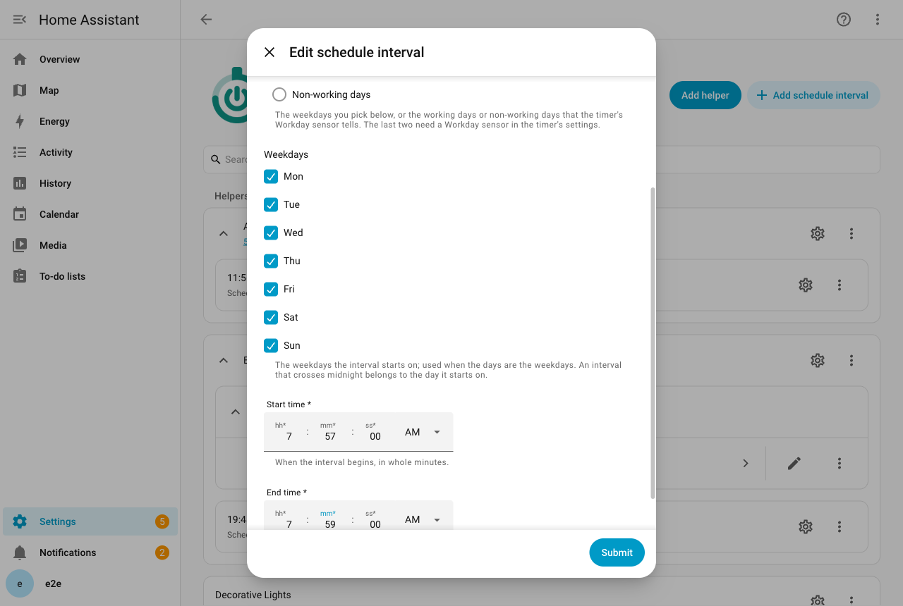
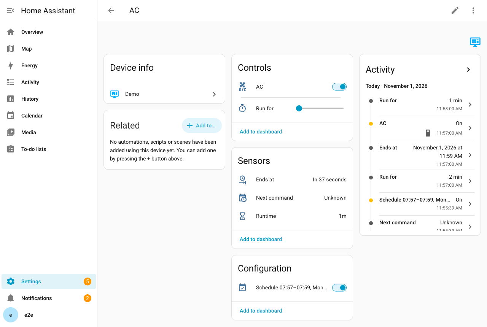

# Schedules

A schedule runs a device at set times of the week, so you do not have to start it yourself.

## Run a device at set times each week

A schedule is made of intervals. An interval says "the device should run from this time to that time, on these days".

A timer can have any number of intervals. Each has its own days, times and settings. A boiler that heats on working-day mornings, and a little later on days off, needs two intervals.

On each day an interval applies, it opens at its start time and closes at its end time. That stretch of time is the interval's **window**.

When a window opens, Timerify sets the countdown to end where the window ends. The device turns on, and it turns itself off at the end, like any other countdown. So everything on the [Timers](timers.md) page applies. **Run for**, the [**Add time** action](services.md#add-time) and the [other actions](services.md) work on a countdown that a window started.

What happens when you start or change the timer yourself is described under [How a schedule and your own changes meet](#how-a-schedule-and-your-own-changes-meet).

## Add, edit and delete an interval

Intervals belong to the timer's entry, and you add them one at a time.

1. Open **Settings > Devices & services** and choose **Timerify**. Find the timer's entry.
2. Choose **Add schedule interval**.
3. Fill in the form and submit it.

The entry lists each interval with a menu to **Edit** or **Delete** it. The form asks for:

- **Days**: the weekdays you pick, the working days, or the non-working days. See [Choose the days](#choose-the-days).
- **Weekdays**: the days the interval starts on. All seven are picked to begin with. It matters only when **Days** is set to the weekdays.
- **Start time** and **End time**, in whole minutes. The two must differ. An end earlier than the start carries the interval past midnight into the next day. For example, 22:00 to 06:00 runs the night. It belongs to the day it starts on.
- **Settings**, for a device that has some. See [Settings of an interval](#settings-of-an-interval). The section is collapsed for a new interval. It is open when you edit an interval that has settings the form shows.

An interval is named by its times and days, in the language Home Assistant is set to. For example: `06:30–07:15, Sun–Thu`. A name that Timerify made follows the edit, in the language Home Assistant is set to at that time. You can rename the interval on the integration page with **Rename**. The name is then yours, and it is kept when you edit the interval. By voice, an interval with the name Timerify made is said by its start time, such as "6:30". A renamed interval is said by its new name. See the [Voice page](voice.md#what-each-sentence-does).

Adding, editing or deleting an interval reloads the timer for a moment, so that it reads its intervals again. The countdown and the pending commands are stored, and they carry on. Deleting an interval removes its switch.

## Choose the days

The **Days** field has three choices:

- **The weekdays picked below**: any set of days of the week. You pick them in the **Weekdays** field.
- **Working days** and **Non-working days**: these follow a Workday sensor.

The Workday sensor is a binary sensor of Home Assistant's [Workday integration](https://www.home-assistant.io/integrations/workday/). It knows your country's public holidays and the working week you set in it. Its default week is Monday to Friday in every country. So set the week in the sensor's own options, in both fields: **Days to include** and **Days to exclude**. A day in both lists is excluded.

In Israel, include Sunday to Thursday, and exclude Friday, Saturday and holidays.

Timerify follows the sensor. A boiler that runs "on working days at 06:30" skips a holiday on its own.

### The Workday sensor of a timer

The Workday sensor belongs to the timer. If your house has one, the last step of adding a timer asks for it. The first interval you add then offers working days from the start.

To set it, change it or take it away later, open the timer's entry and choose **Configure**. The sensor is the last step. It is optional. A timer without one has weekday intervals only.

If you rename the sensor, the timer follows it to the new entity id and reloads. A window that is open stays open.

If you delete the sensor, the timer keeps its id. It waits, as it does for an unavailable sensor (see below), until you pick another one in **Configure**.

### Things to know about the Workday sensor

- **Use a sensor with a days offset of 0.** That is the default of the Workday integration. Timerify asks the sensor about the day an interval starts on, and takes its answer as it is. A sensor with an offset of 1 answers for the day after, and the schedule would run shifted by a day.
- **An interval of working days or non-working days needs the timer's Workday sensor.** The interval form refuses these days on a timer without one. **Configure** refuses to remove the sensor while an interval uses it. Change or delete those intervals first.
- **A timer whose stored intervals need a sensor it does not have does not load.** Only a hand-edited file can cause this. The timer says why. Reload it after you fix the file.
- **An unavailable sensor stops new windows, not running ones.** The sensor may be unavailable, the Workday integration may not be loaded, or its answer may fail. Then Timerify cannot tell whether a day is a working one. The windows it has already worked out stay. A window that is open runs to its end. One that has not begun still begins. No new window of a working-day or non-working-day interval is worked out until the sensor answers. So on the morning after the sensor went away, nothing starts.
- **The log carries one warning for each outage.** It says which sensor and why. Timerify tries again whenever the sensor changes or reports. The Workday integration reports at every midnight. When the sensor answers, a window that is open is run for its remainder.
- **Intervals of weekdays do not depend on the sensor.**

## Clock changes and time zones

Windows follow the clock on the wall, in Home Assistant's time zone.

- A window across midnight lasts what the clock says. For working days, the day that counts is the day the window starts on.
- On the days the clock changes, a window starts and ends at its wall times. In Israel in 2026, a window from 23:00 to 07:00 lasts 7 hours on the night the clock goes forward. It lasts 9 hours on the night the clock goes back.
- A time that does not exist happens an hour later. Take 02:30 on the night the clock jumps from 02:00 to 03:00. It happens at 03:30. So 02:10 to 02:50 runs from 03:10 to 03:50 that day.
- That can put the start at or after the end, as with 02:30 to 03:15 or 02:50 to 03:10. Then the interval does not run that day.
- A time that happens twice, such as 01:30 when the clock goes back, is its first time.
- A window is never longer than a day, which is the length of the longest countdown.
- Changing Home Assistant's time zone moves the windows. Say you change the zone in `configuration.yaml` and apply it with "Reload core configuration". Timerify does not notice that until a window ends, the Workday sensor reports or the timer is reloaded.

## Switch an interval on or off

Every interval has a switch on the timer's device, named like `Schedule 06:30–07:15, Sun–Thu`. It is on to begin with.

- Switch it off and the interval is skipped. Suppose its window is open and the schedule is running the timer. Then the timer stops at once, or it passes to another open window that wants the device running.
- Switch it on while the window is open, and the device runs for the rest of the window. The exception is a timer that already ends later. An interval that is on already is left as it is. So a device that was turned off during its window stays off until the next one.
- The state is stored with the timer, and it survives restarts. Flipping the switch does not reload the timer.
- The switch's name follows edits of the interval after the reload. The entity id keeps the title the interval had when it was added.

## How a schedule and your own changes meet

A schedule says "the device should run during this window". You always win over it. There are five rules.

Two of them mention the timer's mode, which you can read about under [Modes](timers.md#modes). In **Strict** mode a device runs only while a countdown does. In **Loose** mode it may also run without a countdown.

1. **A window extends a manual run, and never shortens it.** When a window opens, the timer is set to the end of the window. The exception is a timer that already ends later. That one is left alone. Say you started a countdown at 06:20 that ends at 06:40. The 06:30 to 07:15 window makes it end at 07:15. Say you added time so that it ends at 08:00. Then it stays. In Loose mode, a run without a countdown can be going when a window opens. The window cuts it at its own end.
2. **Edits follow the schedule.** Suppose the timer's end was set by a schedule interval, and you have not changed the timer since. Then editing, deleting or switching off that interval moves or stops the timer at once. Say you edit an interval at 07:00 from 06:00 to 08:00 into 06:00 to 07:30. The timer ends at 07:30. If an edit moves a window so that it no longer includes the present moment, the device stops. It starts again at the new start, which is a new window. With overlapping intervals, the timer ends at the latest end of the open windows. So deleting one of two overlapping intervals does not stop a device that the other still wants.
3. **A change of yours ends that.** These are changes of yours: setting **Run for**, adding time, running the timer with the [**Run** action](services.md#run), stopping the timer, and a pending command. Turning on a device that is off while a window is open is one too (see rule 5). After one of them, editing an interval no longer touches the timer. This lasts until the next window sets it. A pending command that falls due at the very moment a window opens is carried out after the window, and it wins. Turning on a device that already runs, without a duration, changes nothing. So it is not a change of yours.
4. **A manual off holds until the next window.** Say the device is turned off after a window has opened. The window does not turn it back on. It does not matter who turned it off. It can be you at the wall, the device's own app or an automation. It can also be **Run for** set to 0, or the end of a countdown you started. The next window does turn it on. This is stored, so a restart does not bring the window back either. Two things start the device again, because they are your acts too. One is editing the interval so that its window no longer includes the present moment. The edit makes a new window, which begins at its own start. The other is switching the interval off and on. You can also turn the device on again yourself. In the same window it then runs to the end of that window (see rule 5).
5. **A turn-on without a length of time, while a window is open, runs to the end of the window.** Turning the device on by hand counts. So do the [**Run** action](services.md#run) without minutes and a pending command to turn on without minutes. In Strict mode the run ends with the window, or with the default duration if that ends later. In Loose mode it gets a countdown to the end of the window. A window you stopped by hand (see rule 4) still counts as open. With overlapping windows, the run ends with the latest one. A length of time you name is kept. After the window has closed, a turn-on is an ordinary manual start. That is the default duration in Strict mode. In Loose mode it has no countdown, but the timer's [limit](timers.md#turn-off-a-device-that-was-left-on) applies, if it has one. The run is a change of yours (see rule 3), so editing the interval does not move it.

## Settings of an interval

An interval can turn the device on the way you want. It has the same settings as a pending command: cooling at 24 degrees on the air conditioner, or a brightness for a light. The form offers only what the device says it can do.

- The settings go out when a window opens and **Timerify turns the device on for it**. That means the device is off, or a turn-off is on its way and the device has not yet answered. An air conditioner gets its mode, then its temperature, then its fan mode.
- **A device that is already running when a window opens gets no settings.** It gets only the extended countdown, because someone chose the current settings. This includes a run started by another interval. It also includes a device that is not on yet but whose turn-on is still wanted: the turn-on is on its way, it waits for an unavailable device, or the call failed. The same goes for a device that was unavailable when the window opened and is already on when it comes back.
- A device that is unavailable at the start keeps the countdown. It is turned on with the settings when it is back, if it is off then and the window is still open.
- A window never replaces the settings of a command that is waiting for the device. The command's turn-on is still wanted, and its settings stay.
- Suppose the turn-on goes through and a settings call fails. The settings are sent again, with the same repeat rules as for a rejected turn-on (see [When the device does not answer](timers.md#when-the-device-does-not-answer)). This holds if the device reports that it is on in response to Timerify's own call.
- A device that only reports later, when it is polled, has the rest of the settings dropped. Timerify does not push settings onto a device that someone else may have set.
- Editing an interval while its window is open does not push the new settings onto the running device. They are used from the next window.
- Suppose a device stops offering a setting of an interval, for example after an update of its integration. Editing the interval keeps the setting as it is, though the form no longer shows it.
- While the device does not take it, **Settings > System > Repairs** shows a warning. Its title names the timer and the interval. Choose the warning to read which settings the device does not take. It has nothing to submit.
- If you keep the setting on purpose, choose **Ignore** on the warning. It stays ignored while the device does not take the setting, also after the timer reloads or Home Assistant restarts. If the device stops taking one more setting of the interval, the warning comes back.
- When the interval turns the device on, that setting is left out, and the log says so. The other settings go out.
- The warning goes away when the device takes the setting again. It also goes when you pick a value the device takes, or delete the interval. A warning that comes back later is not ignored.
- The form cannot drop a setting it no longer shows. To drop one, delete the interval and add it again.

## Restarts

- Windows are stored with the timer. Timerify also stores whether each window has started and whether you stopped it.
- A window that is open when Home Assistant starts, and had already started, leaves the countdown as it was. The countdown still ends where the window ends.
- Suppose a window began while Home Assistant was down, and was not applied yet. At start-up it is applied for the rest of the window. The boiler turns on when Home Assistant is back.
- A countdown that ended while Home Assistant was down turns the device off, as on the [Timers](timers.md#when-home-assistant-restarts) page. Suppose one window ended and the next began during a long outage. Then the device is not switched off and on for it.
- An interval you switched off stays off.

---

[All pages](README.md) · [Back to the README](../../README.md)
