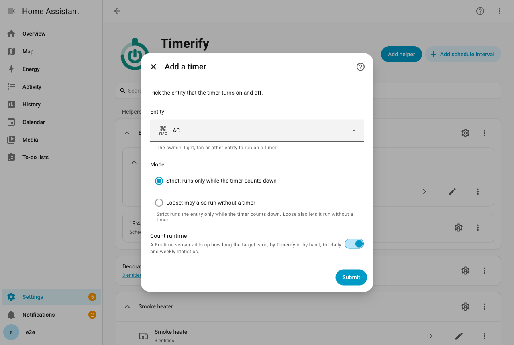
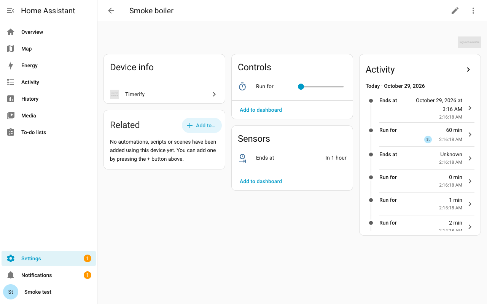

# Timers

This page shows how to add a timer to a device and run it for a set time.

## Add a timer to a device

A timer attaches a countdown to an entity you already have. A plain switch, such as a boiler, gets a "Run for" control on its own device page. Each timer belongs to one entity. These pages call it the device.

1. Open **Settings > Devices & services > Helpers**. Choose **Create helper**, then **Timerify**.
2. In the menu, choose **Add a timer**.
3. Pick the entity and the mode, **Strict** or **Loose**. The [Modes](#modes) section explains both. The [entities you can pick](#which-devices-can-have-a-timer) are listed below.
4. Turn on **Count runtime** if you want the timer to add up how long the device is on. It is off to begin with. The [Runtime page](runtime.md) tells more.
5. Set **Maximum of Run for**, the end of the slider. It is 1440 minutes (one day) to begin with. If you rarely run the device for more than two hours, set 120.
6. Turn on **Turn off button** if you want a button that turns the device off. It is off to begin with.
7. In Strict mode, set the default duration. It cannot be longer than the maximum. In Loose mode, you can set **Turn off if left on for** instead. Leave it empty for no limit. The [Modes](#modes) section explains it.
8. If your house has a Workday sensor, pick the one this timer follows, or leave it empty. Schedules use it.

The timer appears on the device page of the entity. The **Add integration** button on the Integrations tab lists Timerify too, as "Timerify (Helper)". The other item of the menu, **Voice settings**, sets up the voice sentences for Assist. The [Voice page](voice.md#use-the-voice-settings-entry) describes it.

### Change a timer later

Open the timer on the Timerify integration page and choose **Configure**. There you can change the mode and the runtime counter. You can also change **Maximum of Run for**, **Turn off button**, the default duration, **Turn off if left on for** and the Workday sensor.

You cannot change the entity. Add a timer for the other entity instead.

You can rename the entity, move it to another Home Assistant device, or give it a device when it had none. The timer follows it and keeps running.

## Run a device for a set time

Set **Run for** to a number of minutes. The device turns on, and it turns off when the time is up.

- Set **Run for** to a new number while a countdown runs. The countdown restarts from that number.
- Set **Run for** to 0. The device turns off. This also turns off a device that runs without a countdown, in Loose mode.
- While a countdown runs, **Run for** shows the minutes left, rounded up.
- **Ends at** shows the moment the countdown ends. It is unknown while no countdown runs. In Loose mode it can also show a [limit](#turn-off-a-device-that-was-left-on).
- A countdown is a whole number of minutes, from 1 minute up to one day.
- The slider of **Run for** ends at the **Maximum of Run for** you chose.
- Actions, voice, pending commands and schedules can still start a countdown of up to a day. **Run for** then shows more minutes than the slider's end, and the countdown runs in full.
- The same holds when you lower **Maximum of Run for** while a longer countdown runs.

You can also start, extend and stop a timer from a [dashboard card](card.md), [by voice](voice.md), or with [actions](services.md). A [schedule](schedules.md) starts it by itself at set times.

## Modes

Each timer has a mode. You choose it when you add the timer, and you can change it later.

- **Strict** (the default): the device runs only while a countdown does. You also set a default duration. It is 30 minutes to begin with. If **Maximum of Run for** is smaller, it is that instead.
- **Loose**: the device may also run without a countdown. A countdown then only means "turn off when it reaches zero". You can also give it a limit, so that a device left on is turned off in the end.

The default duration is how long a Strict device runs when it is turned on without a length of time. While a schedule window is open, the run lasts to the end of the window instead. If the default duration ends later, the run lasts to its end.

### Turn off a device that was left on

A Loose device that you switch on by hand has no countdown. If you forget it, it runs on. The setting **Turn off if left on for** is a fuse against that. It is a number of minutes, from 1 to 1440. It is empty to begin with, which means no limit. A Strict timer does not have it, because every run of a Strict device has a countdown already.

- A Loose device is on, and Timerify has no countdown for it. Timerify then sets a limit: the moment now, plus the minutes you chose. When the limit comes, Timerify turns the device off.
- A time you chose is never cut. Each of these gives the device a countdown, and there is no limit while it runs:
  - **Run for** and **Add time**.
  - A run or a voice command with minutes.
  - A pending command with minutes.
  - A schedule window.
- Turning the device off ends the limit, whoever does it. The next turn-on without a time starts a new limit.
- These start a limit:
  - You switch the device on by hand.
  - **Run** has no minutes, or a voice command or a pending command names no time.
  - Timerify finds the device on when Home Assistant starts, or when the device comes back from unavailable.
- The limit counts from the moment Timerify sees the device on. A device switched on while Home Assistant was down gets its limit from the start-up.
- **Ends at** shows the moment of the limit. The limit is a bound, not a promise: it is the latest the device stays on. **Run for** stays 0, because nobody chose a time.
- Adding time to a limit gives a countdown that you chose. A limit of 13:30 with 15 minutes added is a countdown to 13:45, and nothing cuts it.
- A limit survives a Home Assistant restart, like a countdown. One that came while Home Assistant was down turns the device off at start-up.
- Changing the settings loads the timer again, and that counts as a start-up. A device that is on with no limit gets one from that moment. A limit that already runs keeps its time.
- If you empty the box or switch to Strict mode, the limit goes away when the timer loads again. The device keeps running. In Strict mode the default duration then applies.

The events and triggers tell an automation when a limit starts and ends. See [Automations](automations.md#what-a-trigger-tells-the-automation).

## What a timer adds to the device page

All the entities of a timer sit on the device's own page in Home Assistant. If the entity is on no Home Assistant device, the timer makes a device named after it. If the entity is linked to a device later, the timer's entities move to that device. They keep their entity ids. Their names keep the same form, unless the new device holds another timer. Then they name the target in brackets, as [A device with two timers](automations.md#a-device-with-two-timers) explains. The device that was made for them is removed.

| Entity | What it shows |
| --- | --- |
| **Run for** (a number) | The minutes left, rounded up. Setting it starts, changes or stops the countdown. |
| **Ends at** (a sensor) | The moment the countdown ends. In Loose mode, a device left on can have a limit. While it runs, the sensor shows the moment of the limit: the latest time the device turns off. It is unknown while neither runs. Home Assistant shows it as, for example, "in 7 minutes". Two attributes go with it. One is the moment the countdown began, which is empty while no countdown runs. The other says whether the time is a limit. The dashboard card draws its fill from the first. |
| **Next command** (a sensor) | The moment the next pending command is due. It is unknown while there is none. See [Pending commands](pending-commands.md#the-next-command-sensor). |
| `Schedule 06:30–07:15, Sun–Thu` (a switch) | One for each schedule interval. It is on while the interval is in use, and off to skip it. See [Schedules](schedules.md#switch-an-interval-on-or-off). |
| **Runtime** (a sensor) | Only when you ask for it. The minutes the device was on, as a total that only goes up. The [Runtime page](runtime.md) tells more. |
| **Turn off** (a button) | Only when you ask for it. Pressing it stops the countdown and turns the device off. It also turns off a device that runs without a countdown, in Loose mode. On the device page it has a **Press** button. |

## When something else switches the device

You, the device's own app, a switch on the wall and an automation can all switch the device. Timerify reacts like this:

- Someone turns the device off: the countdown is cleared. This holds in both modes.
- Someone turns the device on in Strict mode: a countdown starts for the default duration. So a boiler that you switch on at the wall still turns itself off.
- Someone turns the device on in Loose mode: the device is left running without a countdown. If the timer has a [limit](#turn-off-a-device-that-was-left-on), the device is turned off when it comes.
- The exception is a [schedule](schedules.md#how-a-schedule-and-your-own-changes-meet) window that is open at that moment. The countdown then ends with the window, in either mode. In Strict mode it ends with the default duration if that is later.

Starting, changing and stopping the countdown is the only way Timerify itself switches the device. So the rules never contradict each other. A pending command is a change of the countdown that happens later. So is the start of a schedule interval.

## When the device does not answer

- A device that drops off Wi-Fi keeps its countdown. Whatever came due meanwhile is applied when it reports again. For example, a countdown that ended turns it off. The log says what came due while the device was unavailable. It also says so when Home Assistant starts while the device is unavailable. These are info lines, which Home Assistant hides by default. To see them, open the Timerify integration page and choose **Enable debug logging**.
- A command that the device rejects, or accepts without doing anything, is not forgotten. Timerify sends it again when the device next reports its state. It also sends it again when you ask for the same thing again.
- A device that rejects a command gets at most 3 repeats of it, however often it reports or reconnects.
- Then Timerify writes one warning in the log and stops sending that command. It sends it again when you ask again. It also sends it again when the timer itself switches the device: a countdown ends, or a schedule interval starts.
- Remotes and media players get no repeats at all. A repeat could switch a toggle remote back, or disturb a player that is still starting up. They are sent a command again only when you ask again, or when the timer itself switches them.

## When the device is deleted

- Say you delete the device or entity that a timer switches. Home Assistant then shows a repair: "The device of timer Boiler was deleted". You see it at the top of **Settings** and under **Settings > System > Repairs**.
- Until you act, the timer switches nothing. It keeps its countdown and its pending commands. What comes due meanwhile is applied when the device is back, as it is for a [device that does not answer](#when-the-device-does-not-answer).
- Add the device again with the same entity ID, and the timer works again by itself. The repair goes away.
- To delete the timer instead, open **Repairs**, choose the repair, then choose **Submit**. The timer goes with its entities, schedule intervals and pending commands. Deleting the timer on its integration page does the same, and takes the repair away.

## When Home Assistant restarts

- A countdown survives a Home Assistant restart. Timerify stores it on every change. At start-up it checks the end time against the clock.
- A countdown that ended while Home Assistant was down turns the device off. So does a limit that came meanwhile.
- A change you make while Home Assistant is still starting is kept and saved. This covers **Run for**, **Add time**, **Run** and pending commands. It also covers the switch of a schedule interval and of the whole schedule. Timerify switches the device once Home Assistant has started.
- Your change counts from the moment you make it. Timerify first applies what came due before it while Home Assistant was down. That can be a countdown that ended, a pending command or a schedule window. Then your change wins, as it does with Home Assistant running.
- A pending command still runs at its own time. A command that came due while Home Assistant was down or still starting is handled at start-up.
- Timerify keeps a timer's state in a file. If that file is not valid JSON, Home Assistant renames it and shows its own repair about it. The timer then starts with no countdown and no pending commands, and every schedule interval is on.
- Suppose the file is valid JSON but holds a timer that Timerify cannot use. For example, a field is missing, or two parts of the file contradict each other. Then the timer does not start.
- **Settings > System > Repairs** then shows "The stored state of the timer Boiler cannot be read".
- To fix it, open **Repairs**, choose the repair, then choose **Submit**. The timer keeps its settings, its schedule intervals and its runtime total. It loses its countdown and its pending commands. A schedule interval that you had switched off is on again.

## Which devices can have a timer

A timer can switch these kinds of entities:

- switches and input booleans;
- lights, fans, humidifiers and sirens;
- remotes and media players;
- climate entities and water heaters;
- groups.

It can also switch any other entity of a kind that has turn-on and turn-off actions, such as an automation. Timerify switches groups and these other entities with the Home Assistant actions `homeassistant.turn_on` and `homeassistant.turn_off`.

- Fans, media players, sirens and climate entities must say that they can be turned on and off. Water heaters must say that they support on and off. A device that works but does not say so is not offered, because Home Assistant itself refuses to switch it.
- Groups and the other entities must report "on" or "off" when you add the timer. A group of covers or locks reports "open" or "locked". Timerify cannot tell whether it is running, so it answers that the entity does not report on or off.
- An entity that is unavailable at that moment gets the same answer. Try again once it is back.
- The picker lists every entity of a kind with both actions, so it also shows cameras. A camera reports "idle" or "streaming", which is not on or off. Adding one is refused with the same answer.
- Vacuum cleaners have no turn-on and turn-off in Home Assistant 2026.10, so they are not offered.

## Settings for turning on

A command that turns the device on can say how. It can set the mode and temperature of an air conditioner, the brightness of a light or the speed of a fan. These are the device's settings.

Timerify offers only what the device says it can do. It checks a request when you make it. A wrong request is refused at once with a message, not when the device is already waiting for it. A device can stop offering a setting later, for example when an update of its integration renames a mode. Then Timerify leaves that setting out when the command or the schedule interval runs. The device gets the rest, and the log names the setting.

Settings are applied in these cases:

- The [**Run** action](services.md#run) with settings turns the device on with them. If the device is already running, it gets them anyway: you asked for them.
- A pending command that turns the device on carries its settings the same way. It applies them at its time, whether the device is running then or not.
- Settings that have not reached the device yet go out with the next turn-on of any kind, whatever causes it. Setting **Run for** does it. So does adding time to a timer that is not running. So does a command that gives no settings of its own. If the device is found running instead, even when you turned it on by hand, they are set then.
- The settings of a schedule interval go out only with the turn-on that the interval makes. They are never pushed onto a device that is already running. See [Settings of an interval](schedules.md#settings-of-an-interval).

When no settings wait, a manual turn-on, setting **Run for** and adding time turn the device on plainly.

An air conditioner is turned on by setting its HVAC mode, when you give one. Without a mode, it is turned on with its plain "turn on". The calls go one after the other: the turn-on (or the mode), then the temperature, then the fan mode.

### When a device cannot take the settings yet

- The device is unavailable, or a call fails. The settings are kept and sent again when the device reports again. The repeat rules are the same as for a rejected turn-on, described in [When the device does not answer](#when-the-device-does-not-answer). The countdown runs meanwhile.
- Settings you give later replace the ones that wait. A command that gives none leaves them alone. So they go out with the next turn-on, whatever causes it.
- The countdown ending drops them, and so does turning the device off by hand.

Timerify trusts what the device accepts. A settings call that returns without an error counts as applied. The device's attributes are not compared afterwards, because devices round values and report late. Only the turn-on is checked against the device's state. A device that says yes and stays off gets the turn-on again, with its settings.

### Which settings a device can take

| Device | Setting | Valid values |
| --- | --- | --- |
| Climate (air conditioner, thermostat) | HVAC mode | One of the modes the entity lists, except off. |
| Climate | Temperature | From the entity's minimum to its maximum temperature. The device must be able to set a target temperature. |
| Climate | Fan mode | One of the entity's fan modes. The device must support fan modes. |
| Light | Brightness | 1 to 100 percent. Only lights that can dim. |
| Fan | Speed | 1 to 100 percent. Only fans that set their speed. |
| Fan | Preset mode | One of the fan's preset modes. The fan must support preset modes. |
| Humidifier | Humidity | From the entity's minimum to its maximum humidity. |
| Humidifier | Mode | One of the humidifier's modes. The humidifier must support modes. |
| Water heater | Temperature | From the entity's minimum to its maximum temperature. The heater must be able to set a target temperature. |
| Water heater | Operation mode | One of the entity's operation modes, except off. The heater must support operation modes. |

Other kinds of devices have no settings. If you ask for a setting that the device does not have, Timerify refuses. Timerify does not check the temperature step that the entity reports. A device may round 22.3 to 22.5. The names of these settings in YAML are on the [Actions](services.md#settings) page.

---

[All pages](README.md) · [Back to the README](../../README.md)
