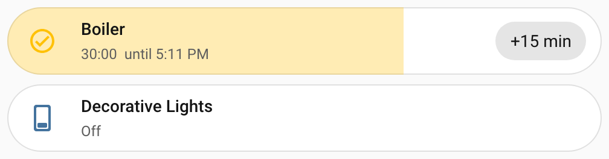
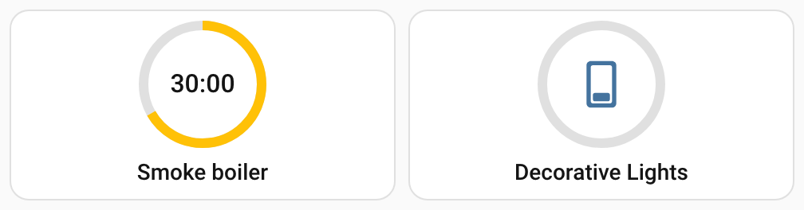
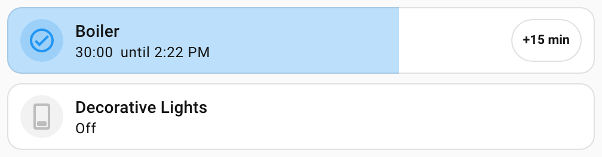
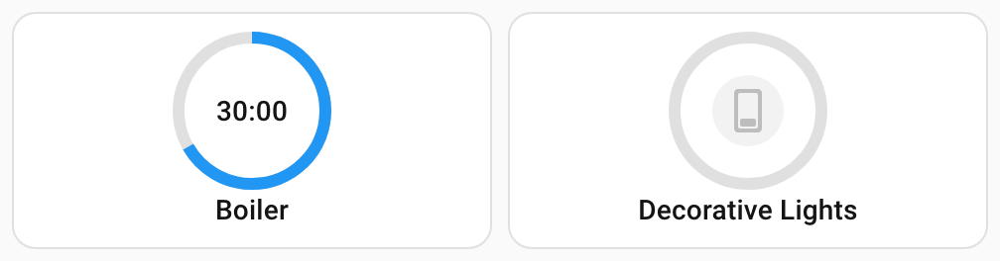

# Карточка на панели

Timerify приносит карточку для панели, которая показывает один таймер. Она показывает отсчёт с первого взгляда.

Нажатие открывает всплывающее окно. В нём вы включаете таймер на заданное время, добавляете или убавляете минуты и останавливаете его. Там же вы переключаете интервалы его расписания и отменяете ожидающие команды. У карточки два вида и визуальный редактор. Можно задать, что делают нажатие, двойное нажатие и долгое нажатие. Ещё на карточку можно добавить кнопку **Выключить** и придать ей вид карточек Mushroom.

## Загрузка карточки

Ничего добавлять не нужно. Timerify отдаёт карточку сам и просит Home Assistant загружать её на каждой панели. Ресурс в разделе **Панели** создавать не нужно. Панели в режиме YAML тоже получают карточку.

Home Assistant читает список модулей для загрузки, когда загружается страница. Поэтому **обновите страницу в браузере один раз после установки или обновления Timerify**.

### Известная проблема в Home Assistant 2026.10

При первой загрузке Home Assistant в браузере, который ещё не закэшировал свой интерфейс, карточка, которую загружает интеграция, может отсутствовать. Так бывает при первом посещении, после очистки данных сайта и при первой загрузке после обновления интерфейса.

Панель тогда показывает «Ошибка конфигурации» и «Custom element doesn't exist: timerify-card». Обновите страницу ещё раз, и карточка появится.

- Это ошибка интерфейса Home Assistant ([home-assistant/frontend#53890](https://github.com/home-assistant/frontend/issues/53890)). С ней встречается каждая такая карточка.
- Она исправлена в интерфейсе, начиная с версии 20261028.0 ([pull request #54444](https://github.com/home-assistant/frontend/pull/54444)). Ожидается, что этот интерфейс будет в Home Assistant 2026.11.
- Timerify не обходит её. Timerify по-прежнему нужен только Home Assistant 2026.10.4. Если поднять минимум до 2026.11, проблема исчезнет ([задача #7](https://github.com/klimofey/timerify/issues/7)).

## Два вида карточки

**Капсула** (`pill`) занимает одну строку в высоту. Её заливка растёт слева. Она показывает долю отсчёта, которая осталась: полная, когда отсчёт начался, и пустая, когда он закончился.

На капсуле значок устройства, его название и оставшееся время с моментом окончания отсчёта. Когда ничего не отсчитывается, вместо них стоит состояние устройства. Необязательная быстрая кнопка, «+15 min» на картинке, добавляет время без открытия окна. Необязательная кнопка **Выключить** стоит перед быстрой кнопкой. См. [Кнопка «Выключить»](#кнопка-выключить).



**Круг** (`round`) делает круглую плитку, которую удобно ставить по несколько в ряд. Кольцо показывает ту же долю. Пока идёт отсчёт, в центре стоит оставшееся время. Иначе в центре значок устройства. Название внизу.

У круглой плитки нет быстрой кнопки. Долгое нажатие на неё запускает или останавливает таймер. См. [Нажатия](#нажатия). Её необязательная кнопка **Выключить** стоит под названием.



- Название и значок берутся у устройства. Значок следует за состоянием устройства, как на любой карточке. Оба можно задать в настройках карточки.
- Устройство, которое включено без отсчёта, показывает полную заливку и полное кольцо. Это допускает **свободный** режим. Он описан в разделе [Режимы](timers.md#режимы). Капсула называет состояние устройства словами. У круглой плитки эти слова только для программ чтения с экрана. Простаивающий таймер показывает пустую заливку и пустое кольцо.
- Таймер, у которого число недоступно, показывает это. Его быстрая кнопка, готовые значения, кнопки «плюс», «минус», «Остановить» и кнопки отмены выключены, а кнопка **Выключить** не показывается. См. [Всплывающее окно](#всплывающее-окно).
- Если объекта карточки не существует или это не число **Включить на** таймера Timerify, карточка так и говорит и называет его. Она сама находит свой таймер, когда объект возвращается. Если вы переименовали число, укажите в карточке его новый идентификатор.
- Бывает, что число принадлежит таймеру, но таймер показать нельзя. Это случается, когда в реестре нет устройства или одного из двух датчиков. Карточка говорит об этом и отправляет вас на страницу таймера, чтобы узнать причину. Она делает это при любом состоянии числа. Сразу после добавления таймера эта строка может на миг появиться. Потом она исчезает сама.
- Карточка никогда не молчит, когда не может работать. Пользователю, которому нельзя видеть таймер, она об этом говорит. См. [Права доступа](#права-доступа).
- Карточке нужны два датчика таймера, **Выключится в** и **Следующая команда**. Она сообщает вам, когда вы отключили один из них.
  - Если отключён **Выключится в**, показывать отсчёт нечем. Карточка показывает только предупреждение, которое называет датчик и просит его включить.
  - Если отключена **Следующая команда**, карточка работает. Во всплывающем окне на месте ожидающих команд сказано, что они скрыты. Там же назван датчик.
  - Включите датчик в настройках его объекта. Home Assistant перезагрузит таймер примерно через полминуты, и карточка вернётся сама.
- Отсчёт продолжается при перезапуске Home Assistant или потере соединения, до того же конца. Карточка снова запрашивает свой таймер, когда соединение возвращается.
- На панели с секциями капсула начинается с ширины 6 столбцов и высоты в одну строку. Её можно сузить до 3 столбцов. Круглая плитка начинается с ширины 3 столбца и высоты 2 строки. Её можно сделать шириной в 2 столбца или высотой в 3 строки. Кнопке **Выключить** нужно больше места. См. [Кнопка «Выключить»](#кнопка-выключить).

## Добавьте карточку

Откройте панель для редактирования, нажмите **Добавить карточку** и найдите **Timerify** среди карточек. Выбор показывает первый из ваших таймеров, и редактор открывается с формой ниже. Либо напишите карточку в YAML.

Каждая настройка показана здесь со значением по умолчанию:

```yaml
type: custom:timerify-card
entity: number.boiler_run_for             # обязательно: число «Включить на» таймера
layout: pill                              # pill (по умолчанию) или round
name: Котёл                               # по умолчанию: название устройства
icon: mdi:water-boiler                    # по умолчанию: значок устройства, он следует за состоянием
presets: ["15", "30", "45", "60", "120"]  # по умолчанию: минуты, которые предлагает окно
chip: 15                                  # по умолчанию кнопки нет: кнопка «+15 мин» на капсуле
show_turn_off: false                      # true показывает кнопку «Выключить», пока устройство включено
mushroom: false                           # true придаёт карточке вид карточек Mushroom, если Mushroom установлен
tap: popup                                # popup (по умолчанию), run, stop, run_or_stop, action или none
double_tap: none                          # те же варианты, по умолчанию none
hold: none                                # те же варианты, на круглой плитке по умолчанию run_or_stop
tap_action:                               # действие Home Assistant, используется при tap: action
  action: more-info
```

| Настройка | По умолчанию | Что это |
| --- | --- | --- |
| `entity` | нет, обязательна | Число **Включить на** таймера. Остальное в таймере карточка находит по нему, а не по устройству. Поэтому два таймера на одном устройстве различаются. |
| `layout` | `pill` | `pill` или `round`. |
| `name` | название устройства | Заменяет название. |
| `icon` | значок устройства | Значок, например `mdi:water-boiler`. Он не следует за состоянием. |
| `presets` | 15, 30, 45, 60 и 120 | Длительности, которые предлагает окно, в целых минутах от 1 до 1440, каждая один раз, в заданном порядке. Подходят и числа, и текст из цифр (`"30"`). Пустой список означает значения по умолчанию. Окно не показывает готовое значение, которое больше, чем задано в поле **Максимум «Включить на»** у таймера. Home Assistant отклонил бы его. |
| `chip` | нет | Целые минуты от 1 до 1440, которые быстрая кнопка капсулы добавляет к отсчёту. Круглая плитка её игнорирует. |
| `show_turn_off` | `false` | `true` показывает на карточке кнопку **Выключить**, пока устройство включено. См. [Кнопка «Выключить»](#кнопка-выключить). |
| `mushroom` | `false` | `true` придаёт карточке вид карточек Mushroom, когда Mushroom установлен. См. [Стиль Mushroom](#стиль-mushroom). |
| `tap` | `popup` | Что делает нажатие. Одно из `popup`, `run`, `stop`, `run_or_stop`, `action` и `none`. См. [Нажатия](#нажатия). |
| `double_tap` | `none` | Что делает двойное нажатие. Те же варианты. |
| `hold` | `run_or_stop` на круглой плитке, `none` на капсуле | Что делает долгое нажатие. Те же варианты. |
| `tap_action`, `double_tap_action`, `hold_action` | нет | Действие Home Assistant, записанное настройками, например `action: more-info`. Оно используется, когда это нажатие настроено на `action`. |

Настройка, которой карточка не знает, игнорируется. Значение, которое она не может использовать, показывается сообщением на карточке, где сказано, что не так.

### Визуальный редактор

В визуальном редакторе есть поле для каждой настройки. Он предлагает только числа **Включить на** таймеров Timerify. Карточка, добавленная из выбора, записывается с видом «капсула» и пятью готовыми значениями по умолчанию, чтобы вы их видели. Что нужно знать о редакторе:

- Он записывает готовые значения как текст (`"15"`). Записывайте их текстом и в YAML, если потом правите карточку в форме. Список чисел (`[15, 30]`) форма показывает голыми кнопками («15», а не «15 мин»). Её выпадающий список снова предлагает значения по умолчанию, даже когда они уже в списке. Выбор такого значения добавляет вторую копию, которую карточка игнорирует.
- Если убрать последнее готовое значение, список останется пустым, а это значит значения по умолчанию.
- Под полем **Стиль Mushroom** написано **Mushroom не найден**, пока карточки Mushroom не загружены на странице. См. [Стиль Mushroom](#стиль-mushroom).
- Три нажатия и их действия собраны в группе **Взаимодействия**. Она закрыта, пока вы её не откроете. Нажатие, которое вы не задали, показывается пустым полем и делает то, что задано по умолчанию.
- Значение, которое форма принимает, а карточка использовать не может, например готовое значение 0, остаётся в форме. Предпросмотр показывает сообщение карточки. В YAML редактор отправляет только значение неверного вида. Пример: готовые значения, которые не список.
- Карточка, написанная вручную без вида, это капсула. Но форма её не выбирает заранее, потому что редактор Home Assistant не применяет значения формы по умолчанию.
- Названия полей переводит сам Home Assistant. Часть слов он так не переводит: два вида, шесть вариантов нажатия и подписи готовых значений. Они даны на языке последней карточки, которую загрузила страница. Пока на странице не загрузилась ни одна карточка, они на английском.

## Всплывающее окно

По умолчанию нажатие в любом месте карточки открывает окно, включая рамку. Исключение составляют быстрая кнопка и кнопка **Выключить**, у каждой своя задача. Карточка служит кнопкой и для клавиатуры, и для вспомогательных технологий. Наведите на неё фокус клавишей Tab и нажмите Enter или пробел.

Окно модальное. Его закрывают Escape, кнопка **Закрыть** и щелчок по затемнённой странице за ним. Сверху вниз в нём:

- **Оставшееся время** и момент окончания, пока идёт отсчёт.
- **Готовые значения.** Нажатие на одно включает таймер на это время, как установка **Включить на**. Идущий отсчёт начинается заново. Готовое значение, которое больше, чем задано в поле **Максимум «Включить на»** у таймера, не показывается. Если не осталось ни одного, этот ряд убирается.
- **Убавить 5 минут, добавить 5 минут и Остановить.** Убавить время можно, пока идёт отсчёт. Добавление времени простаивающему таймеру запускает его, как [действие **Добавить время**](services.md#добавить-время). Остановить предлагается, пока таймер работает, с отсчётом или без. Оно выключает устройство и завершает отсчёт.
- **Расписание**, когда у таймера есть интервалы. Для каждого интервала показан выключатель с его названием. Каждый из них включает и выключает [выключатель интервала](schedules.md#включение-и-выключение-интервала). Интервалы здесь не создают и не изменяют. Для этого есть страница таймера. Интервал, у которого выключатель недоступен, показан как недоступный, и нажать его нельзя.
- **Ожидающие команды**, когда они есть. Каждая выглядит, например, так: «Включить: 7:30, на 1 ч» или «Выключить: вт 07:00». Рядом её настройки («Охлаждение, 24 °C») и кнопка × для отмены. Если датчик **Следующая команда** отключён, вместо них стоит одна строка. Она говорит, что команды скрыты из-за этого.
- **Настройки**, ссылка на страницу таймера в настройках интеграции. Её видят только администраторы. Она открывается в той же вкладке и закрывает окно. Ctrl, Cmd или Shift вместе с щелчком открывают её в новой вкладке или окне, и окно остаётся.

У недоступного таймера действовать не на что. Его готовые значения, кнопки «плюс», «минус», «Остановить» и кнопки отмены выключены, как и быстрая кнопка капсулы. Кнопка **Выключить** не показывается. Когда Home Assistant отказывает в действии, он показывает своё сообщение об ошибке, и окно остаётся открытым.

Время следует вашему профилю: его языку, 12- или 24-часовым часам и часовому поясу, серверному или браузерному. Время в тот же день показывается как время. В пределах следующих шести дней оно показывается с коротким названием дня недели. Дальше оно показывается с датой. Длительности вроде «1 ч 30 мин» пишутся для вашего языка.

## Кнопка «Выключить»

Во всплывающем окне есть кнопка **Остановить**. Кнопку **Выключить** можно показать и на самой карточке. Тогда вы останавливаете таймер, не открывая окно. По умолчанию кнопки нет. Включите её полем **Показывать кнопку «Выключить»** в визуальном редакторе. В YAML напишите `show_turn_off: true`.

- Кнопка показывается, пока устройство включено, с отсчётом или без него. Пока идёт отсчёт, она показывается, даже если устройство недоступно.
- Она не показывается, пока устройство выключено. Она не показывается, пока таймер недоступен или карточка ещё не нашла свой таймер.
- На капсуле она стоит рядом с названием, перед быстрой кнопкой. На круглой плитке она под названием. На узкой карточке кнопка показывает только значок питания. Программы чтения с экрана по-прежнему говорят **Выключить**, а подсказка показывает это слово при наведении. Капсула без быстрой кнопки начинается с ширины 6 столбцов, и на этом размере кнопка показывает значок. На широком экране слово появляется с 7 столбцов.
- Нажатие делает то же, что **Остановить** во всплывающем окне. Оно завершает отсчёт и выключает устройство. Это [действие **Остановить**](services.md#остановить). Оно выключает и устройство, которое работает без отсчёта, в **свободном** режиме.
- Нажатие на неё не считается нажатием, двойным нажатием или долгим нажатием на карточку. Окно не открывается.
- Она работает независимо от настройки таймера **Добавить кнопку «Выключить»**. Та настройка добавляет кнопку на страницу устройства. См. [Что таймер добавляет на страницу устройства](timers.md#что-таймер-добавляет-на-страницу-устройства).
- На панели с секциями капсулу с кнопкой нельзя сделать уже 6 столбцов. Если есть ещё и быстрая кнопка, капсула начинается с 9 столбцов и уже не сужается. На телефоне шириной 320 пикселей названию тогда остаётся мало места.
- Круглая плитка с кнопкой выше: на панели с секциями это 3 строки, а не 2, и не уже 3 столбцов. Её место остаётся свободным, пока устройство выключено. Поэтому кольцо не сдвигается, когда кнопка появляется.

## Нажатия

Можно задать, что делают нажатие, двойное нажатие и долгое нажатие. Вот значения по умолчанию:

| Нажатие | По умолчанию |
| --- | --- |
| Нажатие | Открывает всплывающее окно. |
| Двойное нажатие | Ничего. |
| Долгое нажатие | На круглой плитке запускает или останавливает таймер. На капсуле ничего. |

В визуальном редакторе три нажатия задают поля **При нажатии**, **При двойном нажатии** и **При длительном нажатии**. Последнее задаёт долгое нажатие.

Каждое нажатие можно настроить на один из шести вариантов. Визуальный редактор называет их так, как в первом столбце. Во втором столбце значение для YAML.

| Вариант | Значение | Что делает |
| --- | --- | --- |
| Открыть всплывающее окно | `popup` | Открывает [всплывающее окно](#всплывающее-окно). |
| Запустить на время по умолчанию | `run` | Запускает таймер, как [действие **Запустить**](services.md#запустить) без длительности. В **строгом** режиме устройство включается на длительность по умолчанию. В **свободном** режиме оно включается без отсчёта. Оба режима описаны в разделе [Режимы](timers.md#режимы). Таймер, который уже идёт, сохраняет свой отсчёт. |
| Остановить | `stop` | Останавливает таймер, как [действие **Остановить**](services.md#остановить). Оно завершает отсчёт и выключает устройство. |
| Запустить или остановить | `run_or_stop` | Запускает простаивающий таймер, как **Запустить на время по умолчанию**. Останавливает таймер, который идёт, с отсчётом или без него. Недоступный таймер ничего не делает. |
| Действие Home Assistant | `action` | Выполняет [действие Home Assistant](#действия-home-assistant), которое вы выберете. |
| Ничего не делать | `none` | Ничего не делает. |

Долгое нажатие длится полсекунды. Кольцо круглой плитки начинает пульсировать, и значок капсулы тоже. Это значит, что отпускание сработает. У недоступного таймера действовать не на что, поэтому его кольцо и значок остаются неподвижными. Если отпустить рано, это обычное нажатие. Если увести палец или курсор с карточки до того, как отпустить, нажатие отменяется.

У карточки, у которой долгое нажатие настроено на «Ничего не делать», долгого нажатия нет. Мышью долгое нажатие на ней считается обычным нажатием, пальцем оно ничего не делает.

Когда задано двойное нажатие, обычное нажатие ждёт четверть секунды: не последует ли второе. Если последует, срабатывает только двойное нажатие. Если нет, срабатывает обычное. Поэтому всплывающее окно открывается чуть позже, чем без двойного нажатия. Без него нажатие срабатывает сразу.

Enter и пробел делают то же, что нажатие, и сразу. У клавиатуры нет ни двойного, ни долгого нажатия. Поэтому оставьте на нажатии всплывающее окно, если карточкой пользуются с клавиатуры. Остальные нажатия тогда служат быстрыми действиями для мыши и пальца.

### Действия Home Assistant

Настройте нажатие на **Действие Home Assistant**, чтобы дать ему одно из действий, которые предлагают собственные карточки Home Assistant. У каждого нажатия своё поле для него: **Действие при нажатии**, **Действие при двойном нажатии** и **Действие при длительном нажатии**. В поле на выбор: **Показать дополнительную информацию**, **Переключить**, **Перейти на страницу**, **Перейти по URL-адресу**, **Выполнить действие**, **Запустить Assist** и **Ничего не делать**. Поле используется, только когда его нажатие настроено на **Действие Home Assistant**.

- Действие выполняется над устройством, которое включает таймер, а не над числом **Включить на**. **Показать дополнительную информацию** открывает окно устройства. **Переключить** переключает устройство. Timerify затем следит за устройством так же, как когда его переключает кто-то другой. См. [Когда устройство переключает кто-то другой](timers.md#когда-устройство-переключает-кто-то-другой).
- Если оставить в поле **По умолчанию**, Home Assistant откроет окно устройства.
- Пока карточка не нашла свой таймер, она ничего не делает. Это занимает мгновение после загрузки страницы.

Эта круглая плитка по долгому нажатию открывает окно устройства, а по нажатию запускает или останавливает таймер. Двойное нажатие открывает всплывающее окно:

```yaml
type: custom:timerify-card
entity: number.boiler_run_for
layout: round
tap: run_or_stop
double_tap: popup
hold: action
hold_action:
  action: more-info
```

## Стиль Mushroom

[Mushroom](https://github.com/piitaya/lovelace-mushroom) это набор карточек, которым многие пользуются на своих панелях. Стиль Mushroom придаёт карточке Timerify их вид, чтобы она хорошо смотрелась рядом. По умолчанию он выключен.

Включите его полем **Стиль Mushroom** в визуальном редакторе. В YAML напишите `mushroom: true`.





- Для стиля нужен Mushroom. Установите его сами, например через HACS. Timerify его не устанавливает и не использует его код.
- Карточка ищет Mushroom в вашем браузере. Она видит Mushroom, как только его карточки загрузились. Это может случиться позже, чем загрузится сама карточка. Тогда она сразу принимает стиль.
- Без Mushroom карточка сохраняет вид Home Assistant. Визуальный редактор пишет под полем **Mushroom не найден**.
- Значок стоит в круглой форме. Пока устройство включено, форма окрашена, а пока выключено, она серая. У капсулы углы обычной карточки, а не круглые края.
- Название, состояние, кнопка **Выключить** и быстрая кнопка принимают размеры и шрифты Mushroom. Карточка такой же высоты, как карточка Mushroom с таким же значком.
- Всплывающее окно сохраняет свой вид.

Тема, которая задаёт переменные Mushroom, меняет и карточку Timerify. Карточка читает их так же, как карточки Mushroom. Для переменной, которой в теме нет, она берёт значение, которое берёт Mushroom. Задавайте переменные в теме Home Assistant, как для Mushroom. Больший отступ или размер значка делает карточку выше.

| Переменная | Что она меняет на карточке | Значение у Mushroom |
| --- | --- | --- |
| `--mush-spacing` | Отступ вокруг значка и текста и между ними. | `10px` |
| `--mush-icon-size`, `--mush-icon-border-radius`, `--mush-icon-symbol-size` | Размер формы значка, её скругление и размер самого значка в ней. | `36px`, `50%`, `0.667em` |
| `--mush-card-primary-font-size`, `-font-weight`, `-line-height`, `-letter-spacing`, `-color` | Название и оставшееся время на круглой плитке. Каждая переменная начинается с `--mush-card-primary`. | `14px`, `500`, `20px`, `0.1px`, цвет текста |
| `--mush-card-secondary-font-size`, `-font-weight`, `-line-height`, `-letter-spacing`, `-color` | Строка состояния капсулы. Каждая переменная начинается с `--mush-card-secondary`. | `12px`, `400`, `16px`, `0.4px`, цвет текста |
| `--mush-control-height`, `--mush-control-border-radius`, `--mush-control-button-ratio`, `--mush-control-icon-size`, `--mush-control-spacing` | Кнопка **Выключить**. | `42px`, `12px`, `1`, `0.5em`, `12px` |
| `--mush-chip-height`, `--mush-chip-border-radius`, `--mush-chip-padding`, `--mush-chip-font-size`, `--mush-chip-font-weight` | Быстрая кнопка капсулы. Рамка, фон и тень кнопки тоже задаются переменными `--mush-chip`. | `36px`, `19px`, `0 0.25em`, `0.3em`, `bold` |
| `--mush-rgb-state-entity` | Цвет значка, заливки и кольца, пока устройство включено, тремя числами. | `33, 150, 243` |
| `--mush-rgb-disabled` | Цвет значка, пока устройство выключено или недоступно, тремя числами. | `189, 189, 189` в светлой теме, `111, 111, 111` в тёмной |

## Что делает карточка

У карточки нет собственного таймера. Всё, что она показывает, читается из состояний объектов таймера. Всё, что она делает, это вызов действия или объекта Timerify.

| Карточка показывает | Откуда читает |
| --- | --- |
| Отсчёт и заливку | Датчик **Выключится в** и момент начала отсчёта, который является [атрибутом этого датчика](services.md#что-можно-прочитать-у-таймера) |
| Состояние устройства, название и значок | Состояние устройства |
| Интервалы | Выключатели интервалов |
| Ожидающие команды | Список команд датчика **Следующая команда**, который является [атрибутом этого датчика](services.md#что-можно-прочитать-у-таймера) |

| Карточка делает | Чем |
| --- | --- |
| Включает на готовое значение | Установкой **Включить на** |
| Добавляет или убавляет время, быстрая кнопка | [Действием **Добавить время**](services.md#добавить-время) |
| Нажатие, настроенное на **Запустить на время по умолчанию**, или на **Запустить или остановить** при простаивающем таймере | [Действием **Запустить**](services.md#запустить) без длительности |
| Останавливает: кнопка **Остановить** в окне, кнопка **Выключить**, нажатие, настроенное на **Остановить**, и нажатие, настроенное на **Запустить или остановить**, пока таймер идёт | [Действием **Остановить**](services.md#остановить) |
| Нажатие, настроенное на **Действие Home Assistant** | Собственным обработчиком действий Home Assistant, над устройством таймера |
| Отменяет команду | [Действием **Отменить команду**](services.md#отменить-команду) |
| Переключает интервал | Включением или выключением его выключателя |

Чтобы узнать, какие объекты принадлежат её таймеру, карточка спрашивает Timerify через [собственную команду](services.md#команда-для-карточки-на-панели). Ответ берётся только из записи таймера и реестра Home Assistant. Поэтому карточка получает ответ, даже пока таймер запускается. Ответ называет и настройки устройства, которые выражены в процентах. Поэтому карточка пишет яркость или скорость вентилятора 40 как процент, а не как голое число.

На сервере для карточки ничего не отсчитывается. Карточка считает раз в секунду. Она делает это, только пока идёт отсчёт и карточка находится на странице.

Карточка считает по часам Home Assistant, а не по часам браузера. В ответе Timerify указано, сколько времени на сервере. Карточка запоминает разницу с часами браузера. Поэтому часы браузера, которые ошибаются на минуты, не меняют оставшееся время. Настенный планшет с уходящими часами показывает верный отсчёт. Показанное время окончания, например «до 16:42», тоже следует часам сервера. Так же определяется день, который указан рядом со временем, если оно не сегодняшнее.

Карточка измеряет разницу заново, когда спрашивает заново, например когда возвращается соединение. Если часы браузера скачком изменятся между этими моментами, отсчёт будет неверным до следующего измерения. Даже тогда оставшееся время не опускается ниже 0:00. Заливка остаётся между пустой и полной. То, что вы нажимаете, всегда уходит на сервер.

## Права доступа

Карточка и её окно работают для каждого пользователя, который может видеть и контролировать объекты таймера, администратор он или нет. Пользователь, который не администратор, видит всё, кроме ссылки «Настройки». Эта страница только для администраторов.

Команда Timerify для карточки открыта для каждого пользователя. Она сообщает пользователю только то, что он вправе читать. Пользователь, который не вправе читать число, устройство или два датчика таймера, ответа не получает. Тогда карточка вместо таймера показывает предупреждение «У вас нет прав видеть таймер», за которым идёт идентификатор его числа, на языке пользователя. Интервал, чей выключатель пользователь не вправе читать, во всплывающее окно не попадает.

Модуль карточки отдаётся всем, потому что браузер загружает его до того, как кто-либо вошёл.

## Языки

Собственные слова карточки, её кнопки и сообщения, даны на английском и русском, на языке вашего профиля. Для любого другого языка они на английском. Время, длительности и числа пишет браузер для вашего языка, поэтому они верны на любом языке. Названия и состояния объектов принадлежат Home Assistant.

Визуальный редактор берёт часть названий у последней карточки, которую загрузила страница. Это названия видов, готовых значений и вариантов нажатия. Пока на странице не загрузилась ни одна карточка, они на английском.

---

[Все страницы](README.md) · [Назад к README](../../README.ru.md)
