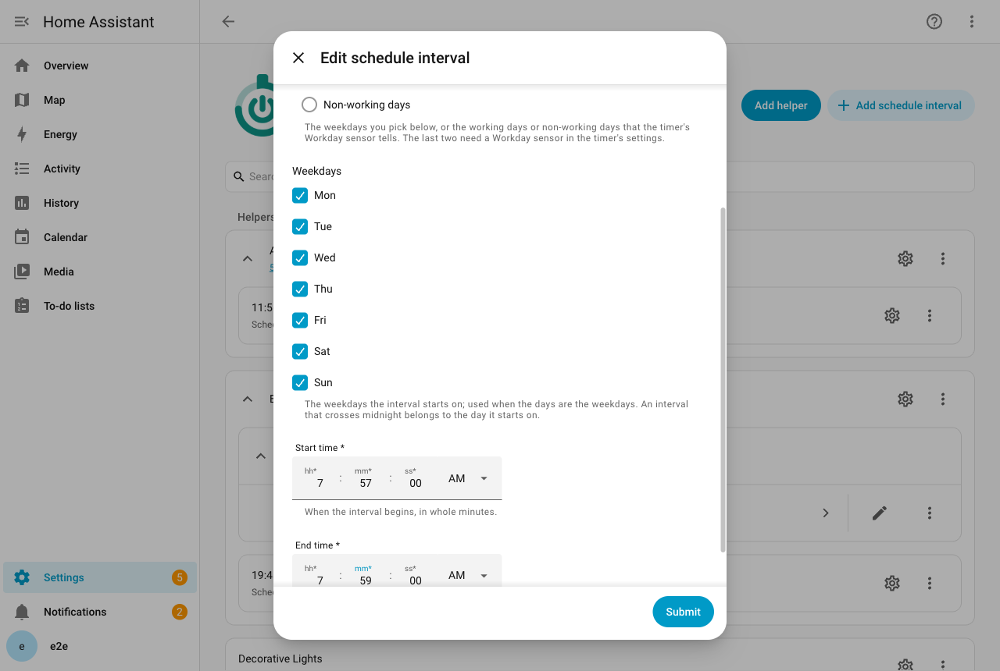
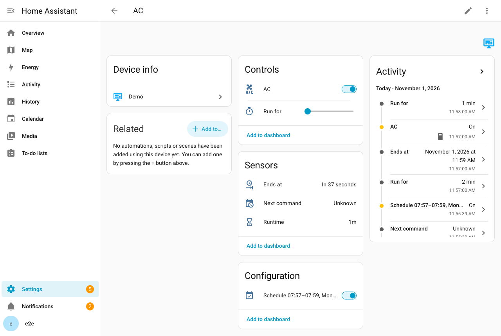

# Расписания

Расписание запускает устройство в заданное время недели, так что вам не нужно включать его самому.

## Запускайте устройство в заданное время каждую неделю

Расписание состоит из интервалов. Интервал говорит: «устройство должно работать с этого времени до этого, в эти дни».

У таймера может быть сколько угодно интервалов. У каждого свои дни, время и настройки. Котёл, который греет по утрам в рабочие дни и чуть позже в выходные, требует двух интервалов.

В каждый день, когда интервал действует, он открывается в своё время начала и закрывается в своё время окончания. Этот отрезок времени называется **окном** интервала.

Когда окно открывается, Timerify ставит отсчёт так, чтобы он закончился там, где заканчивается окно. Устройство включается и само выключается в конце, как при любом другом отсчёте. Поэтому всё, что сказано на странице [«Таймеры»](timers.md), действует и здесь. **Включить на**, [действие **Добавить время**](services.md#добавить-время) и [остальные действия](services.md) работают с отсчётом, который запустило окно.

О том, что происходит, когда вы сами запустили или изменили таймер, рассказано в разделе [Как расписание сочетается с вашими изменениями](#как-расписание-сочетается-с-вашими-изменениями).

## Добавление, изменение и удаление интервала

Интервалы принадлежат записи таймера, и вы добавляете их по одному.

1. Откройте **Настройки > Устройства и службы** и выберите **Timerify**. Найдите запись таймера.
2. Нажмите **Добавить интервал расписания**.
3. Заполните форму и отправьте её.

В записи каждый интервал показан с меню, где его можно **Изменить** или **Удалить**. Форма спрашивает:

- **Дни**: дни недели, которые вы отметите, рабочие дни или нерабочие дни. См. [Выбор дней](#выбор-дней).
- **Дни недели**: дни, в которые интервал начинается. Сначала отмечены все семь. Это важно, только когда в поле **Дни** выбраны дни недели.
- **Начало** и **Окончание**, с точностью до минуты. Эти два времени должны отличаться. Окончание раньше начала переносит интервал через полночь на следующие сутки. Например, интервал с 22:00 до 06:00 работает ночью. Он относится к дню, в который начался.
- **Настройки**, если они есть у устройства. См. [Настройки интервала](#настройки-интервала). У нового интервала этот раздел свёрнут. Он открыт, когда вы изменяете интервал с настройками, которые показывает форма.

Интервал называется по своему времени и дням, на языке, который выбран в Home Assistant. Например: `06:30–07:15, Вс–Чт`. Название, которое создал Timerify, меняется вместе с интервалом, на языке, который выбран в Home Assistant в этот момент. Интервал можно переименовать на странице интеграции, пунктом меню **Переименовать**. Тогда название ваше, и оно сохраняется при изменении интервала. Голосом интервал с названием от Timerify называют по времени начала, например «6:30». Переименованный интервал называют новым названием. См. страницу [«Голос»](voice.md#что-делает-каждая-фраза).

Добавление, изменение или удаление интервала на мгновение перезагружает таймер, чтобы он заново прочитал свои интервалы. Отсчёт и ожидающие команды сохранены и продолжают идти. При удалении интервала удаляется и его выключатель.

## Выбор дней

Поле **Дни** предлагает три варианта:

- **Дни недели, отмеченные ниже**: любой набор дней недели. Вы отмечаете их в поле **Дни недели**.
- **Рабочие дни** и **Нерабочие дни**: они следуют за датчиком Workday.

Датчик Workday является бинарным датчиком [интеграции Workday](https://www.home-assistant.io/integrations/workday/) Home Assistant. Он знает государственные праздники вашей страны и рабочую неделю, которую вы в нём задали. По умолчанию рабочая неделя в любой стране идёт с понедельника по пятницу. Поэтому задайте неделю в собственных настройках датчика, в обоих полях: «Days to include» и «Days to exclude». День, который есть в обоих списках, исключается.

В Израиле включите дни с воскресенья по четверг, а пятницу, субботу и праздники исключите.

Timerify следует за датчиком. Котёл, который включается «в рабочие дни в 06:30», сам пропускает праздник.

### Датчик Workday таймера

Датчик Workday принадлежит таймеру. Если он есть в вашем доме, последний шаг добавления таймера спрашивает о нём. Первый добавленный интервал тогда сразу предлагает рабочие дни.

Чтобы задать датчик, заменить его или убрать позже, откройте запись таймера и нажмите **Настроить**. Датчик выбирается на последнем шаге. Он необязателен. У таймера без датчика бывают только интервалы по дням недели.

Если вы переименуете датчик, таймер последует за ним к новому идентификатору объекта и перезагрузится. Открытое окно остаётся открытым.

Если вы удалите датчик, таймер сохранит его идентификатор. Он ждёт, как и при недоступном датчике (см. ниже), пока вы не выберете другой через **Настроить**.

### Что нужно знать о датчике Workday

- **Используйте датчик со смещением в днях, равным 0.** Это значение по умолчанию в интеграции Workday. Timerify спрашивает датчик о дне, в который интервал начинается, и принимает ответ как есть. Датчик со смещением 1 отвечает про следующий день, и расписание сдвинулось бы на сутки.
- **Интервалу по рабочим или нерабочим дням нужен датчик Workday таймера.** Форма интервала отклоняет такие дни для таймера без датчика. **Настроить** не даёт убрать датчик, пока его использует какой-нибудь интервал. Сначала измените или удалите эти интервалы.
- **Таймер, сохранённым интервалам которого нужен датчик, а датчика нет, не загружается.** Такое возможно только из-за файла, изменённого вручную. Таймер сообщает причину. Перезагрузите его после исправления файла.
- **Недоступный датчик останавливает новые окна, но не идущие.** Датчик может быть недоступен, интеграция Workday может быть не загружена, или её ответ может не прийти. Тогда Timerify не может понять, рабочий ли день. Окна, которые он уже вычислил, остаются. Открытое окно работает до конца. Ещё не начавшееся всё равно начнётся. Новые окна интервалов по рабочим или нерабочим дням не вычисляются, пока датчик не ответит. Поэтому утром после пропажи датчика ничего не запускается.
- **В журнал пишется одно предупреждение на каждый сбой.** В нём сказано, какой датчик и почему. Timerify пробует снова, когда датчик меняется или сообщает состояние. Интеграция Workday сообщает его каждую полночь. Когда датчик отвечает, открытое окно запускается на оставшееся время.
- **Интервалы по дням недели от датчика не зависят.**

## Перевод часов и часовые пояса

Окна идут по настенным часам, в часовом поясе Home Assistant.

- Окно через полночь длится столько, сколько показывают часы. Для рабочих дней считается день, в который окно началось.
- В дни перевода часов окно начинается и заканчивается по настенному времени. В Израиле в 2026 году окно с 23:00 до 07:00 длится 7 часов в ночь, когда часы переводят вперёд. Оно длится 9 часов в ночь, когда часы переводят назад.
- Время, которого не существует, наступает на час позже. Возьмите 02:30 в ночь, когда часы перескакивают с 02:00 на 03:00. Оно наступает в 03:30. Поэтому интервал с 02:10 до 02:50 в тот день идёт с 03:10 до 03:50.
- Из-за этого начало может совпасть с концом или оказаться позже него, как у интервалов с 02:30 до 03:15 и с 02:50 до 03:10. Тогда интервал в этот день не работает.
- Время, которое наступает дважды, например 01:30 при переводе часов назад, считается по первому разу.
- Окно никогда не бывает длиннее суток: это длина самого длинного отсчёта.
- Смена часового пояса Home Assistant сдвигает окна. Допустим, вы изменили пояс в `configuration.yaml` и применили его через «Reload core configuration». Timerify заметит это, только когда закончится окно, датчик Workday сообщит состояние или таймер перезагрузят.

## Включение и выключение интервала

У каждого интервала есть выключатель на устройстве таймера с названием вроде `Расписание 06:30–07:15, Вс–Чт`. Сначала он включён.

- Выключите его, и интервал пропускается. Допустим, его окно открыто и таймером управляет расписание. Тогда таймер сразу останавливается или переходит к другому открытому окну, которому нужно, чтобы устройство работало.
- Включите его, пока окно открыто, и устройство проработает до конца окна. Исключение: таймер, который и так заканчивается позже. Интервал, который уже включён, остаётся как есть. Поэтому устройство, выключенное во время своего окна, остаётся выключенным до следующего.
- Состояние хранится вместе с таймером и переживает перезапуски. Переключение выключателя не перезагружает таймер.
- Название выключателя меняется вслед за изменением интервала, после перезагрузки. Идентификатор объекта сохраняет название, которое было у интервала при добавлении.

## Как расписание сочетается с вашими изменениями

Расписание говорит: «устройство должно работать в течение этого окна». Последнее слово всегда за вами. Правил пять.

Два из них упоминают режим таймера, о котором рассказано в разделе [Режимы](timers.md#режимы). В **строгом** режиме устройство работает только пока идёт отсчёт. В **свободном** режиме оно может работать и без отсчёта.

1. **Окно продлевает ручной запуск и никогда его не сокращает.** Когда окно открывается, таймер ставится на конец окна. Исключение: таймер, который и так заканчивается позже. Его не трогают. Допустим, вы запустили в 06:20 отсчёт, который кончается в 06:40. Окно с 06:30 до 07:15 продлевает его до 07:15. Допустим, вы добавили время, и отсчёт кончается в 08:00. Тогда он остаётся как есть. В свободном режиме запуск без отсчёта, который идёт, когда окно открывается, обрывается в конце окна.
2. **Изменения следуют за расписанием.** Допустим, конец таймера задал интервал расписания, и вы с тех пор не меняли таймер. Тогда изменение, удаление или выключение этого интервала сразу сдвигает или останавливает таймер. Допустим, в 07:00 вы меняете интервал с 06:00 до 08:00 на интервал с 06:00 до 07:30. Таймер закончится в 07:30. Если изменение сдвигает окно так, что оно больше не охватывает текущий момент, устройство останавливается. Оно снова включится в новое время начала: это новое окно. Если интервалы пересекаются, таймер заканчивается в самое позднее время конца из открытых окон. Поэтому удаление одного из двух пересекающихся интервалов не выключает устройство, которое всё ещё нужно другому.
3. **Ваше изменение это прекращает.** Ваши изменения: установка **Включить на**, добавление времени, запуск таймера [действием **Запустить**](services.md#запустить), остановка таймера и ожидающая команда. Включение выключенного устройства, пока окно открыто, тоже ваше изменение (см. правило 5). После любого из них изменение интервала больше не трогает таймер. Так длится, пока следующее окно не задаст таймер снова. Ожидающая команда, время которой пришло в тот самый миг, когда открылось окно, выполняется после окна и побеждает. Включение уже работающего устройства без указания длительности ничего не меняет. Поэтому это не ваше изменение.
4. **Ручное выключение держится до следующего окна.** Допустим, устройство выключили после того, как окно открылось. Окно не включает его снова. Неважно, кто его выключил. Это можете быть вы у стены, собственное приложение устройства или автоматизация. Это может быть и **Включить на**, установленное в 0, или окончание отсчёта, который вы запустили. Следующее окно устройство включит. Это сохраняется, поэтому перезапуск тоже не возвращает окно. Устройство снова запускают две вещи, потому что их делаете вы сами. Первая: изменение интервала так, что его окно больше не охватывает текущий момент. Изменение создаёт новое окно, которое начинается в своё время начала. Вторая: выключение и повторное включение интервала. Вы можете и сами снова включить устройство. В том же окне оно тогда работает до конца этого окна (см. правило 5).
5. **Включение без указания времени, пока окно открыто, длится до конца окна.** Включение вручную тоже считается. Это же верно для [действия **Запустить**](services.md#запустить) без минут и для ожидающей команды включения без минут. В строгом режиме запуск кончается вместе с окном или с длительностью по умолчанию, если она кончается позже. В свободном режиме у запуска появляется отсчёт до конца окна. Окно, которое вы остановили вручную (см. правило 4), всё равно считается открытым. Если окна пересекаются, запуск кончается вместе с самым поздним. Время, которое вы указали, сохраняется. Когда окно закрылось, включение снова становится обычным ручным запуском. В строгом режиме действует длительность по умолчанию. В свободном режиме отсчёта нет, но действует [предел](timers.md#выключите-устройство-которое-забыли-выключить) таймера, если он задан. Этот запуск ваш (см. правило 3), поэтому изменение интервала его не сдвигает.

## Настройки интервала

Интервал может включать устройство так, как вам нужно. У него те же настройки, что у ожидающей команды: охлаждение до 24 градусов для кондиционера или яркость для света. Форма предлагает только то, что устройство умеет само.

- Настройки уходят, когда открывается окно и **Timerify сам включает для него устройство**. Это значит, что устройство выключено или что выключение уже в пути, а устройство ещё не ответило. Кондиционер получает свой режим, затем температуру, затем режим вентилятора.
- **Устройство, которое уже работает, когда окно открывается, настроек не получает.** Оно получает только продлённый отсчёт, потому что текущие настройки кто-то выбрал. Сюда относится запуск, начатый другим интервалом. Сюда же относится устройство, которое ещё не включено, но включение для него всё ещё нужно: оно уже в пути, оно ждёт, пока вернётся недоступное устройство, или вызов не удался. То же верно для устройства, которое было недоступно, когда окно открылось, и уже включено, когда оно возвращается.
- Устройство, недоступное в начале, сохраняет отсчёт. Оно включается с настройками, когда возвращается, если к тому времени выключено и окно ещё открыто.
- Окно никогда не заменяет настройки команды, которая ждёт устройство. Включение этой команды по-прежнему нужно, и её настройки остаются.
- Допустим, включение прошло, а вызов настроек не удался. Настройки отправляются снова, по тем же правилам повторов, что у отклонённого включения (см. [Когда устройство не отвечает](timers.md#когда-устройство-не-отвечает)). Это верно, если устройство сообщает, что оно включено, в ответ на собственный вызов Timerify.
- Устройство, которое сообщает только позже, при опросе, остаток настроек теряет. Timerify не навязывает настройки устройству, которое мог настроить кто-то другой.
- Изменение интервала, пока его окно открыто, не навязывает новые настройки работающему устройству. Они используются со следующего окна.
- Допустим, устройство перестало предлагать настройку интервала, например после обновления его интеграции. Изменение интервала сохраняет эту настройку как есть, хотя форма её больше не показывает.
- Пока устройство её не принимает, в разделе **Настройки > Система > Устранение проблем** есть предупреждение. В его заголовке названы таймер и интервал. Откройте предупреждение, чтобы прочитать, какие настройки устройство не принимает. Подтверждать в нём нечего.
- Если вы сохраняете настройку намеренно, выберите в предупреждении **Игнорировать**. Оно остаётся игнорируемым, пока устройство не принимает настройку, в том числе после перезагрузки таймера или перезапуска Home Assistant. Если устройство перестанет принимать ещё одну настройку интервала, предупреждение появится снова.
- Когда интервал включает устройство, эта настройка пропускается, и журнал об этом сообщает. Остальные настройки уходят.
- Предупреждение исчезает, когда устройство снова принимает настройку. Оно исчезает и тогда, когда вы выберете значение, которое устройство принимает, или удалите интервал. Если предупреждение вернётся позже, оно уже не игнорируется.
- Форма не может убрать настройку, которую она больше не показывает. Чтобы убрать её, удалите интервал и добавьте его снова.

## Перезапуски

- Окна сохраняются вместе с таймером. Timerify также хранит, начиналось ли каждое окно и останавливали ли вы его.
- Окно, которое открыто при запуске Home Assistant и уже начиналось, оставляет отсчёт как был. Отсчёт по-прежнему кончается там, где кончается окно.
- Окно, которое началось, пока Home Assistant был выключен, и ещё не применялось, применяется при запуске на оставшуюся часть окна. Котёл включается, когда Home Assistant возвращается.
- Отсчёт, который закончился, пока Home Assistant был выключен, выключает устройство, как на странице [«Таймеры»](timers.md#когда-home-assistant-перезапускается). Допустим, во время долгого сбоя одно окно закончилось, а следующее началось. Тогда устройство из-за этого не выключается и не включается.
- Интервал, который вы выключили, остаётся выключенным.

---

[Все страницы](README.md) · [Назад к README](../../README.ru.md)
