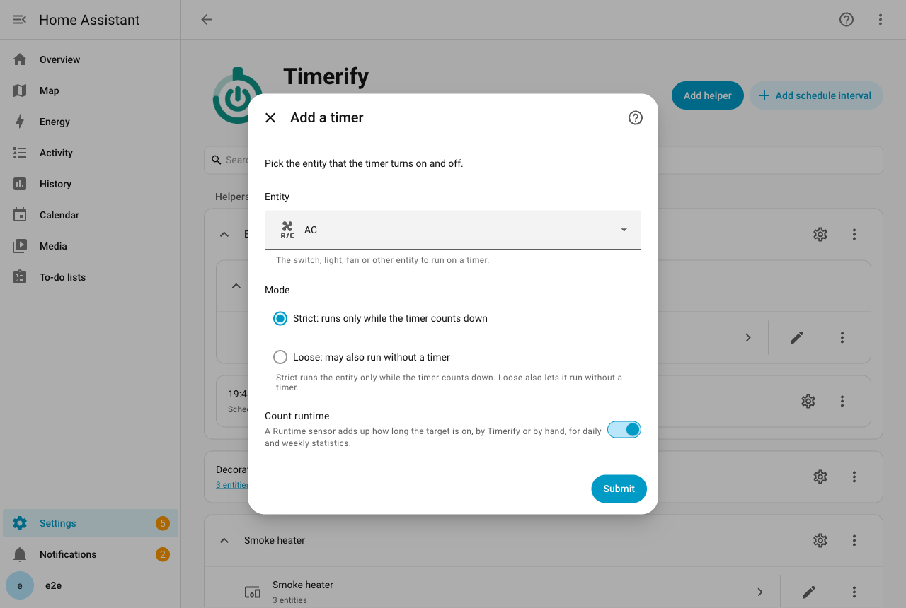
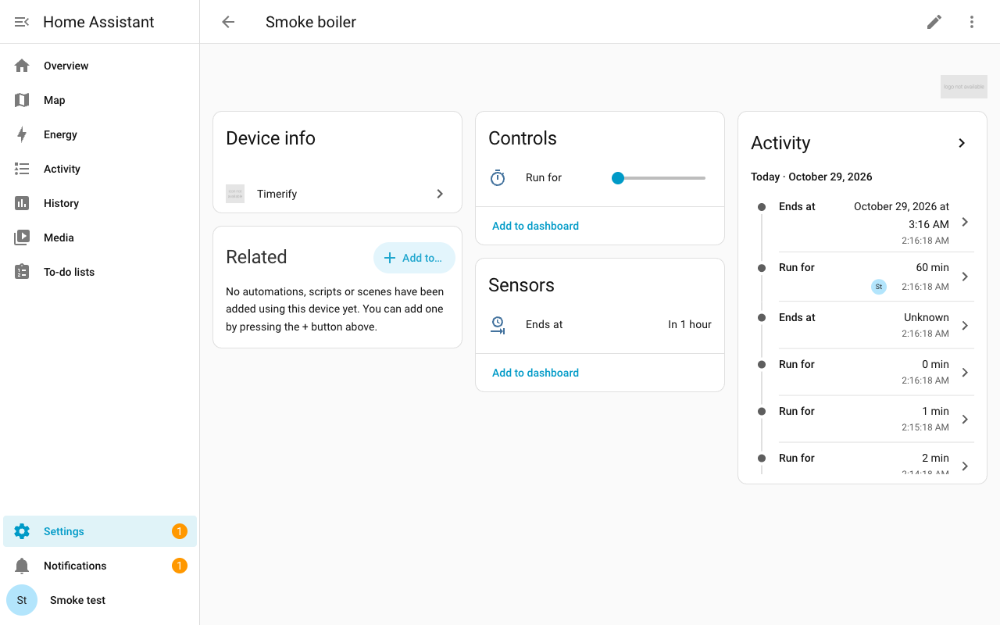

# Таймеры

На этой странице показано, как добавить таймер к устройству и включить его на заданное время.

## Добавьте таймер к устройству

Таймер добавляет отсчёт к объекту, который у вас уже есть. Обычный выключатель, например котёл, получает на странице своего устройства элемент «Включить на». Каждый таймер принадлежит одному объекту. На этих страницах его называют устройством.

1. Откройте **Настройки > Устройства и службы > Вспомогательное**. Нажмите **Создать вспомогательный объект**, затем выберите **Timerify**.
2. В меню выберите **Добавить таймер**.
3. Выберите объект и режим, **Строгий** или **Свободный**. Оба описаны в разделе [Режимы](#режимы). Объекты, которые можно выбрать, [перечислены ниже](#для-каких-устройств-можно-создать-таймер).
4. Включите **Считать время работы**, если хотите, чтобы таймер складывал, сколько времени устройство было включено. Сначала эта настройка выключена. Подробнее об этом на странице [«Счётчик времени работы»](runtime.md).
5. Задайте **Максимум «Включить на»**, конец ползунка. Сначала он равен 1440 минутам (суткам). Если вы редко включаете устройство больше чем на два часа, задайте 120.
6. Включите настройку **Добавить кнопку «Выключить»**, если вам нужна кнопка, которая выключает устройство. Сначала эта настройка выключена.
7. В строгом режиме задайте длительность по умолчанию. Она не может быть больше максимума. В свободном режиме можно задать вместо неё **Выключить, если забыли, через**. Оставьте поле пустым, если предел не нужен. Он описан в разделе [Режимы](#режимы).
8. Если в вашем доме есть датчик Workday, выберите тот, за которым следует этот таймер, или оставьте поле пустым. Датчик нужен расписаниям.

Таймер появится на странице устройства этого объекта. Кнопка **Добавить интеграцию** на вкладке «Интеграции» тоже показывает Timerify, под названием «Timerify (Helper)». Другой пункт меню, **Голосовые настройки**, настраивает голосовые фразы для Assist. Он описан на странице [«Голос»](voice.md#используйте-запись-голосовые-настройки).

### Измените таймер позже

Откройте таймер на странице интеграции Timerify и нажмите **Настроить**. Здесь можно изменить режим и счётчик времени работы. Можно также изменить **Максимум «Включить на»**, настройку **Добавить кнопку «Выключить»**, длительность по умолчанию, **Выключить, если забыли, через** и датчик Workday.

Объект изменить нельзя. Вместо этого добавьте таймер для другого объекта.

Объект можно переименовать, перенести в другое устройство Home Assistant или привязать к устройству, если его не было. Таймер последует за ним и продолжит работать.

## Включите устройство на заданное время

Задайте для **Включить на** число минут. Устройство включится, а когда время выйдет, выключится.

- Задайте для **Включить на** новое число, пока идёт отсчёт. Отсчёт начнётся заново с этого числа.
- Задайте для **Включить на** значение 0. Устройство выключится. Так выключается и устройство, которое работает без отсчёта, в свободном режиме.
- Пока идёт отсчёт, **Включить на** показывает оставшиеся минуты, округлённые вверх.
- **Выключится в** показывает момент, когда отсчёт закончится. Пока отсчёта нет, значение неизвестно. В свободном режиме он может показывать и [предел](#выключите-устройство-которое-забыли-выключить).
- Отсчёт задаётся целым числом минут: от 1 минуты до суток.
- Ползунок **Включить на** заканчивается на значении, которое вы задали в поле **Максимум «Включить на»**.
- Действия, голос, ожидающие команды и расписания по-прежнему могут запустить отсчёт на срок до суток. Тогда **Включить на** показывает больше минут, чем конец ползунка, а отсчёт идёт полностью.
- То же верно, если вы уменьшаете **Максимум «Включить на»**, пока идёт более длинный отсчёт.

Таймером можно управлять и с [карточки на панели](card.md), [голосом](voice.md) или с помощью [действий](services.md). [Расписание](schedules.md) запускает его само в заданное время.

## Режимы

У каждого таймера есть режим. Вы выбираете его при добавлении таймера и можете изменить позже.

- **Строгий** (по умолчанию): устройство работает только пока идёт отсчёт. Вы также задаёте длительность по умолчанию. Сначала она равна 30 минутам. Если **Максимум «Включить на»** меньше, она равна ему.
- **Свободный**: устройство может работать и без отсчёта. Тогда отсчёт означает лишь «выключить, когда дойдёт до нуля». Можно также задать предел: тогда устройство, которое забыли выключить, выключится само.

Длительность по умолчанию показывает, сколько работает устройство в строгом режиме, когда его включают без указания времени. Пока открыто окно расписания, запуск длится до конца окна. Если длительность по умолчанию кончается позже, запуск длится до её конца.

### Выключите устройство, которое забыли выключить

Устройство в свободном режиме, которое вы включили вручную, работает без отсчёта. Если о нём забыть, оно будет работать дальше. Настройка **Выключить, если забыли, через** страхует от этого. Это число минут от 1 до 1440. Сначала поле пустое: это значит, что предела нет. В строгом режиме её нет, потому что у каждого запуска там уже есть отсчёт.

- Устройство в свободном режиме включено, а отсчёта для него у Timerify нет. Тогда Timerify задаёт предел: текущий момент плюс выбранные вами минуты. Когда предел наступает, Timerify выключает устройство.
- Время, которое вы выбрали, никогда не обрывается. Отсчёт появляется в этих случаях, и пока он идёт, предела нет:
  - **Включить на** и **Добавить время**.
  - Запуск или голосовая команда с минутами.
  - Ожидающая команда с минутами.
  - Окно расписания.
- Выключение устройства завершает предел, кто бы его ни выключил. Следующее включение без времени начинает новый предел.
- Предел появляется в таких случаях:
  - Вы включаете устройство вручную.
  - У действия **Запустить** нет минут, либо голосовая или ожидающая команда не называет время.
  - Timerify находит устройство включённым, когда запускается Home Assistant или когда устройство возвращается из состояния «недоступно».
- Предел отсчитывается с момента, когда Timerify видит устройство включённым. Устройство, включённое, пока Home Assistant был выключен, получает предел от запуска.
- **Выключится в** показывает момент предела. Это граница, а не обещание: самое позднее время, до которого устройство остаётся включённым. **Включить на** остаётся равным 0, потому что никто не выбирал время.
- Добавление времени к пределу даёт отсчёт, который выбрали вы. Предел 13:30 с добавленными 15 минутами становится отсчётом до 13:45, и его ничто не обрывает.
- Предел переживает перезапуск Home Assistant, как и отсчёт. Предел, который наступил, пока Home Assistant был выключен, выключает устройство при запуске.
- Изменение настроек загружает таймер заново, а это считается запуском. Включённое устройство без предела получает его с этого момента. Предел, который уже идёт, сохраняет своё время.
- Если вы очистите поле или перейдёте в строгий режим, предел исчезнет, когда таймер загрузится заново. Устройство продолжит работать. В строгом режиме тогда действует длительность по умолчанию.

События и триггеры сообщают автоматизации, когда предел начинается и заканчивается. См. [Автоматизации](automations.md#что-триггер-сообщает-автоматизации).

## Что таймер добавляет на страницу устройства

Все объекты таймера находятся на странице собственного устройства в Home Assistant. Если у объекта нет устройства Home Assistant, таймер создаёт устройство с его именем. Если объект позже привяжут к устройству, объекты таймера переедут на это устройство. Их идентификаторы сохранятся. Названия останутся такими же по форме, если на новом устройстве нет другого таймера. Если он там есть, в скобках в названиях появится название объекта, как объясняет раздел [Устройство с двумя таймерами](automations.md#устройство-с-двумя-таймерами). Созданное для них устройство удаляется.

| Объект | Что он показывает |
| --- | --- |
| **Включить на** (число) | Оставшиеся минуты, округлённые вверх. Если задать значение, отсчёт начнётся, изменится или остановится. |
| **Выключится в** (датчик) | Момент, когда отсчёт закончится. В свободном режиме у устройства, которое забыли выключить, может быть предел. Пока он идёт, датчик показывает момент предела: самое позднее время, когда устройство выключится. Если нет ни отсчёта, ни предела, значение неизвестно. Home Assistant показывает его, например, как «через 7 минут». У датчика два атрибута. Первый хранит момент, когда отсчёт начался, и пуст, пока отсчёта нет. Второй говорит, предел ли это время. Карточка на панели рисует заливку по первому. |
| **Следующая команда** (датчик) | Момент, когда наступит время следующей ожидающей команды. Пока её нет, значение неизвестно. См. [Ожидающие команды](pending-commands.md#датчик-следующая-команда). |
| `Расписание 06:30–07:15, Вс–Чт` (выключатель) | По одному на каждый интервал расписания. Включён, пока интервал используется, и выключен, чтобы его пропустить. См. [Расписания](schedules.md#включение-и-выключение-интервала). |
| **Время работы** (датчик) | Только если вы попросите. Минуты, в течение которых устройство было включено, общей суммой, которая только растёт. Подробнее на странице [«Счётчик времени работы»](runtime.md). |
| **Выключить** (кнопка) | Только если вы попросите. Нажатие останавливает отсчёт и выключает устройство. Кнопка выключает и устройство, которое работает без отсчёта, в свободном режиме. На странице устройства её нажимают кнопкой **Нажать**. |

## Когда устройство переключает кто-то другой

Устройство могут переключить вы, его собственное приложение, выключатель на стене и автоматизация. Timerify реагирует так:

- Кто-то выключил устройство: отсчёт сбрасывается. Это верно в обоих режимах.
- Кто-то включил устройство в строгом режиме: начинается отсчёт на длительность по умолчанию. Поэтому котёл, который вы включили на стене, всё равно сам выключится.
- Кто-то включил устройство в свободном режиме: устройство остаётся включённым без отсчёта. Если у таймера есть [предел](#выключите-устройство-которое-забыли-выключить), устройство выключается, когда он наступает.
- Исключение: в этот момент открыто окно [расписания](schedules.md#как-расписание-сочетается-с-вашими-изменениями). Тогда отсчёт кончается вместе с окном, в любом режиме. В строгом режиме он кончается вместе с длительностью по умолчанию, если она кончается позже.

Сам Timerify переключает устройство только одним способом: запускает, меняет или останавливает отсчёт. Поэтому правила не противоречат друг другу. Ожидающая команда тоже меняет отсчёт, только позже. Так же действует старт интервала расписания.

## Когда устройство не отвечает

- Устройство, которое пропало из Wi-Fi, сохраняет свой отсчёт. Всё, что наступило за это время, применяется, когда оно снова выйдет на связь. Например, закончившийся отсчёт выключит его. Журнал сообщает, что наступило, пока устройство было недоступно. Он сообщает об этом и тогда, когда Home Assistant запускается, а устройство недоступно. Это информационные записи, а Home Assistant по умолчанию их скрывает. Чтобы их увидеть, откройте страницу интеграции Timerify и выберите **Начать отладку**.
- Команда, которую устройство отклонило или приняло, но не выполнило, не забывается. Timerify посылает её снова, когда устройство в следующий раз сообщит своё состояние. Timerify посылает её снова и тогда, когда вы просите о том же ещё раз.
- Устройство, которое отклоняет команду, получает не больше 3 её повторов, как бы часто оно ни сообщало состояние и ни подключалось снова.
- Затем Timerify пишет в журнал одно предупреждение и перестаёт посылать эту команду. Timerify посылает её снова, когда вы просите ещё раз. Timerify посылает её снова и тогда, когда таймер сам переключает устройство: заканчивается отсчёт или начинается интервал расписания.
- Пульты и медиаплееры вообще не получают повторов. Повтор мог бы вернуть назад пульт, который просто переключает состояние, или помешать плееру, который ещё запускается. Timerify посылает им команду снова только тогда, когда вы просите ещё раз или когда таймер сам переключает устройство.

## Когда устройство удалено

- Допустим, вы удалили устройство или объект, который переключает таймер. Тогда Home Assistant показывает проблему: «Устройство таймера Котёл удалено». Её видно вверху раздела **Настройки** и в разделе **Настройки > Система > Устранение проблем**.
- Пока вы ничего не сделали, таймер ничего не переключает. Он хранит свой отсчёт и ожидающие команды. Всё, что наступило за это время, применяется, когда устройство вернётся, как у [устройства, которое не отвечает](#когда-устройство-не-отвечает).
- Добавьте устройство снова с тем же идентификатором объекта, и таймер заработает сам. Проблема исчезнет.
- Чтобы вместо этого удалить таймер, откройте **Устранение проблем**, выберите проблему, затем нажмите **Подтвердить**. Таймер удалится вместе с его объектами, интервалами расписания и ожидающими командами. То же делает удаление таймера на странице интеграции, и проблема исчезает вместе с ним.

## Когда Home Assistant перезапускается

- Отсчёт переживает перезапуск Home Assistant. Timerify сохраняет его при каждом изменении. При запуске Timerify сверяет время окончания с часами.
- Отсчёт, который закончился, пока Home Assistant был выключен, выключает устройство. Так же выключает его предел, который наступил за это время.
- Изменение, которое вы делаете, пока Home Assistant ещё запускается, сохраняется. Это относится к **Включить на**, **Добавить время**, **Запустить** и к ожидающим командам. Это относится и к выключателю интервала, и к выключателю всего расписания. Timerify переключает устройство, когда Home Assistant запустится.
- Ваше изменение действует с того момента, когда вы его сделали. Сначала Timerify применяет то, что наступило до него, пока Home Assistant был выключен. Это может быть закончившийся отсчёт, ожидающая команда или окно расписания. Затем побеждает ваше изменение, как и при работающем Home Assistant.
- Ожидающая команда по-прежнему выполняется в своё время. Команду, срок которой наступил, пока Home Assistant был выключен или запускался, Timerify обрабатывает при запуске.
- Если файл, в котором Timerify хранит состояние таймера, не является корректным JSON, Home Assistant переименовывает файл и показывает собственную проблему о нём. Таймер тогда запускается без отсчёта и без ожидающих команд, а все интервалы расписания включены.
- Допустим, файл корректен как JSON, но в нём таймер, который Timerify не может использовать. Например, не хватает поля или две части файла противоречат друг другу. Тогда таймер не запускается.
- В разделе **Настройки > Система > Устранение проблем** появляется проблема «Сохранённое состояние таймера Котёл не читается».
- Чтобы её устранить, откройте **Устранение проблем**, выберите проблему, затем нажмите **Подтвердить**. Таймер сохраняет свои настройки, интервалы расписания и общее время работы. Отсчёт и ожидающие команды стираются. Интервал расписания, который вы выключили, снова включён.

## Для каких устройств можно создать таймер

Таймер может переключать такие объекты:

- выключатели и переключатели-помощники (input boolean);
- освещение, вентиляторы, увлажнители и сирены;
- пульты и медиаплееры;
- климатические устройства и водонагреватели;
- группы.

Он может переключать и любой другой объект того вида, у которого есть действия включения и выключения, например автоматизацию. Группы и такие объекты Timerify переключает действиями Home Assistant `homeassistant.turn_on` и `homeassistant.turn_off`.

- Вентиляторы, медиаплееры, сирены и климатические устройства должны сообщать, что их можно включать и выключать. Водонагреватели должны сообщать, что поддерживают включение и выключение. Устройство, которое работает, но не сообщает об этом, не предлагается: Home Assistant сам отказывается его переключать.
- Группы и остальные объекты должны сообщать «on» или «off», когда вы добавляете таймер. Группа жалюзи или замков сообщает «open» или «locked». Timerify не может понять, работает ли она, и отвечает, что объект не сообщает, включён он или выключен.
- Объект, который в этот момент недоступен, получает тот же ответ. Повторите попытку, когда он вернётся.
- Список выбора показывает все объекты того вида, у которого есть оба действия, поэтому в нём есть и камеры. Камера сообщает «idle» или «streaming», а это не «on» и не «off». Добавление камеры отклоняется тем же ответом.
- У пылесосов в Home Assistant 2026.10 нет действий включения и выключения, поэтому они не предлагаются.

## Настройки при включении

Команда включения может сказать, как включать. Она может задать режим и температуру кондиционера, яркость света или скорость вентилятора. Это настройки устройства.

Timerify предлагает только то, что устройство умеет само. Он проверяет запрос в тот момент, когда вы его делаете. Неверный запрос отклоняется сразу, с сообщением, а не тогда, когда устройство уже его ждёт. Позже устройство может перестать предлагать настройку, например когда обновление его интеграции переименовывает режим. Тогда Timerify пропускает эту настройку, когда выполняется команда или начинается интервал расписания. Устройство получает остальные настройки, а журнал называет пропущенную.

Настройки применяются в таких случаях:

- [Действие **Запустить**](services.md#запустить) с настройками включает устройство с ними. Если устройство уже работает, оно всё равно их получает: вы же их задали.
- Ожидающая команда включения несёт свои настройки так же. Она применяет их в своё время, работает ли устройство к этому моменту или нет.
- Настройки, которые ещё не дошли до устройства, уходят вместе с ближайшим включением любого вида, чем бы оно ни было вызвано. Такое включение вызывает установка **Включить на**, добавление времени к таймеру, который не идёт, и команда без собственных настроек. Если вместо этого устройство оказалось включённым, даже вручную, настройки применяются тогда.
- Настройки интервала расписания уходят только вместе с включением, которое делает сам интервал. Их никогда не навязывают устройству, которое уже работает. См. [Настройки интервала](schedules.md#настройки-интервала).

Когда настроек в очереди нет, ручное включение, установка **Включить на** и добавление времени включают устройство без настроек.

Кондиционер включается установкой режима климата, если вы его указали. Без режима он включается обычной командой «включить». Вызовы идут один за другим: включение (или режим), потом температура, потом режим вентилятора.

### Когда устройство пока не может принять настройки

- Устройство недоступно, или вызов не удался. Настройки сохраняются и отправляются снова, когда устройство снова выйдет на связь. Правила повторов те же, что у отклонённого включения, они описаны в разделе [Когда устройство не отвечает](#когда-устройство-не-отвечает). Отсчёт тем временем идёт.
- Настройки, которые вы зададите позже, заменяют ожидающие. Команда без настроек их не трогает. Поэтому они уходят с ближайшим включением, чем бы оно ни было вызвано.
- Окончание отсчёта сбрасывает их, как и выключение устройства вручную.

Timerify доверяет тому, что устройство приняло. Вызов настроек, который вернулся без ошибки, считается выполненным. Атрибуты устройства потом не сверяются, потому что устройства округляют значения и сообщают с опозданием. По состоянию проверяется только включение. Устройство, которое отвечает «да» и остаётся выключенным, получает включение снова, вместе с настройками.

### Какие настройки принимает устройство

| Устройство | Настройка | Допустимые значения |
| --- | --- | --- |
| Климат (кондиционер, термостат) | Режим климата | Один из режимов, которые перечисляет объект, кроме выключения. |
| Климат | Температура | От минимальной до максимальной температуры объекта. Устройство должно уметь задавать целевую температуру. |
| Климат | Режим вентилятора | Один из режимов вентилятора объекта. Устройство должно поддерживать режимы вентилятора. |
| Свет | Яркость | От 1 до 100 процентов. Только для света, который можно приглушать. |
| Вентилятор | Скорость | От 1 до 100 процентов. Только для вентиляторов, у которых задаётся скорость. |
| Вентилятор | Предустановка | Одна из предустановок вентилятора. Вентилятор должен их поддерживать. |
| Увлажнитель | Влажность | От минимальной до максимальной влажности объекта. |
| Увлажнитель | Режим | Один из режимов увлажнителя. Увлажнитель должен поддерживать режимы. |
| Водонагреватель | Температура | От минимальной до максимальной температуры объекта. Водонагреватель должен уметь задавать целевую температуру. |
| Водонагреватель | Режим работы | Один из режимов работы объекта, кроме выключения. Водонагреватель должен поддерживать режимы работы. |

У устройств других видов настроек нет. Если вы просите настройку, которой у устройства нет, Timerify отказывает. Шаг температуры, о котором сообщает объект, Timerify не проверяет. Устройство может округлить 22,3 до 22,5. Названия этих настроек в YAML есть на странице [«Действия»](services.md#настройки).

---

[Все страницы](README.md) · [Назад к README](../../README.ru.md)
